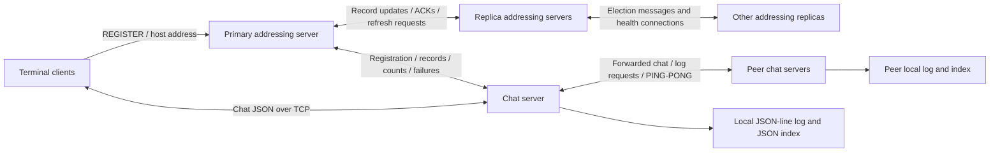

# PROJECT_ANALYSIS

> Transfer source: `Resume_Builder/evidence/distributed-chat-system/PROJECT_ANALYSIS.md` at revision `0793f96beae0a8db7b3890dc70c9383d4c87b2cf`; copied 2026-10-15. Source class: **supporting-analysis**. Privacy edits are listed in `catalog.json`. Original-project links to unavailable artifacts are rendered as code path references. This is a preserved historical investigation, not a new test run or an independently confirmed career record. Statements about the investigation, workspace, file creation, or validation describe that original analysis. Internal code/data paths refer to the investigated project and are not files supplied in this collection.

## Project Name

**IRC-HAT**, a distributed IRC-style terminal chat application. The root README calls it **“IRC-style Chat - You can't spell chat without ‘hat’!”**; the accompanying final paper uses **IRC-HAT**. The Gradle root project is `CPSC559-Group`.

Evidence: `CPSC559-Group/README.md`, `CPSC559-Group/settings.gradle.kts`, and `CPSC 559 Team 16 Final Report.pdf`, page 1.

## Overview

The repository implements a Java chat application with three executable process types: a terminal client, a chat server, and an addressing server. Clients ask an addressing server for a chat server with available capacity, establish a persistent TCP connection to that chat server, register a display name, request recent history, and exchange JSON-encoded messages. Chat servers append messages to local files, broadcast messages to connected clients, and forward messages to other chat servers. Addressing servers maintain in-memory network registries, distribute server records, coordinate some updates through replica acknowledgments, and contain a Bully-style leader-election implementation.

The problem addressed is maintaining chat communication and history across multiple server processes, with mechanisms intended to support reconnection, replicated server discovery information, and recovery from failures. The implementation is a course-project distributed system, not a demonstrated production service. “IRC-style” describes the interaction model: the wire protocol is custom JSON over TCP, not an implementation of the IRC command protocol.

The source establishes substantial networking, persistence, replication coordination, terminal UI, build, and operational work. It also contains unfinished components and inconsistencies that prevent treating all README/final-paper guarantees as verified runtime behavior. In particular, end-to-end encryption, authenticated identities, vector-clock ordering, complete discovery of a newly elected primary, and lossless delivery are **not established by the implementation**. The paper itself identifies discovery limitations and lists authentication, multiple rooms, and encryption as future work (pages 20–21).

### Investigation basis and evidence categories

- **Verified source fact:** an executable code path, declaration, configuration, file, or document was directly inspected. This verifies what the artifact contains; it does not imply successful execution.
- **Technical interpretation:** a conclusion about likely behavior, a failure condition, architectural intent, or complexity derived from those artifacts. These are labeled as interpretations or static findings where relevant.
- **Documented intent/report:** a statement in comments, meeting notes, README, or the final paper. These statements are preserved separately where code does not establish them.
- **Not verified:** behavior, measurements, deployment outcomes, or external context unavailable from the inspected artifacts.

This investigation inspected application sources, ancillary Java files, Gradle configuration and retained alternatives, container definitions, environment files, documentation, meeting notes, and the text of the 22-page final PDF. An additional scan including ignored paths identified pre-existing compiled/build/cache artifacts; those were not treated as current-source verification. No application, build, container, migration, dependency installation, or test harness was run. Only this Markdown file was created. Git inspection was limited to current revision/status, without authorship or commit-history analysis.

### Path conventions

All paths are relative to the workspace containing this file. The Git repository is the nested `CPSC559-Group/` directory; the final paper is its sibling. The following exact prefixes abbreviate evidence references throughout the record:

| Prefix | Directory |
|---|---|
| `R/` | `CPSC559-Group/` |
| `AS/` | `CPSC559-Group/addressingserver/src/main/java/io/github/cpsc559/team16/addressingserver/` |
| `CS/` | `CPSC559-Group/chatserver/src/main/java/io/github/cpsc559/team16/chatserver/` |
| `CL/` | `CPSC559-Group/client/src/main/java/io/github/cpsc559/team16/client/` |
| `CU/` | `CPSC559-Group/common/src/main/java/io/github/cpsc559/team16/common/utilities/` |
| `CM/` | `CPSC559-Group/common/src/main/java/io/github/cpsc559/team16/common/messaging/` |
| `CD/` | `CPSC559-Group/common/src/main/java/io/github/cpsc559/team16/common/dto/` |
| `CE/` | `CPSC559-Group/common/src/main/java/io/github/cpsc559/team16/common/exceptions/` |
| `TM/` | `CPSC559-Group/tests/src/main/java/io/github/cpsc559/team16/tests/` |
| `TT/` | `CPSC559-Group/tests/src/test/java/io/github/cpsc559/team16/tests/` |

## Repository Scope

### Major areas

| Area | Contents and relationship |
|---|---|
| `R/common/` | Shared message envelopes, typed protocol factories, DTOs, TCP framing, file-backed chat history, custom exceptions, network interface, process-ID utility. Used by the three applications. |
| `R/addressingserver/` | Registry/discovery service, registration coordination, replication event tracking, record distribution, failure cleanup, health probes, leader election, replica restart logic. |
| `R/chatserver/` | Selector-driven client/peer connections, worker dispatch, username registration, local broadcast, history responses, peer forwarding, log-transfer protocol, heartbeat monitor. |
| `R/client/` | JLine terminal application with connection management and four dedicated worker-thread classes. |
| `R/tests/` | Separate Gradle file, Dockerfile, environment configuration, reflective manual runner, network/model harnesses, and a wholly commented-out JUnit test body. Not included by root settings. |
| `R/coles-ui-simulator/` | Standalone in-memory terminal prototype with simulated server queues and delays; outside the configured application source sets. |
| Build/deployment root | Gradle root/settings/wrapper, three application Dockerfiles, one debug Dockerfile, Compose file, healthcheck script, environment file, Docker guide. |
| Documentation | README, seven meeting-note files, extensive source comments, empty chat-server README, and the sibling final PDF. |
| Placeholders | `config/application.properties`, `data/chat_history.JSON`, `scripts/deploy.sh`, and `scripts/run_tests.sh` contain whitespace only. |
| Retained alternatives | Client/chat-server `.kts.old` files, addressing-server `.kts.modified`, and substantial commented Docker automation inside the active addressing build file. |
| Generated/local material | Gradle wrapper, ignored `.gradle/`, `build/`, `bin/`, distribution archives, JARs, compilation stashes, and `.DS_Store` files. These are not additional custom application features. |

### Source inventory and counting scope

The non-ignored source inventory contains **79 `.java` files**. Of these, **69** are under `src/main/java` in the **four root-included modules**: addressing server **22**, chat server **9**, client **7**, common **31**. These counts include scaffolding and declarations; they are not counts of completed features or public classes. The remaining ten files are five manual-test implementation files, one JUnit shell, three module-local test/placeholder files, and one simulator.

The common module's 31 files comprise **16 messaging**, **8 utilities**, **5 DTO/role**, and **2 exception** files. There are **four configured Gradle subprojects**, not five: `tests` has its own build file but is absent from `settings.gradle.kts`.

Counts were obtained by enumerating `rg --files --hidden CPSC559-Group -g '!.git'`, filtering `.java`, and classifying paths; configuration inclusion was checked against root settings. A scan with ignored files enabled separately identified generated/local material. This avoids counting compiled classes or dependencies as original source.

## Contributions

Per the repository owner's instruction, original project implementation is attributed to the owner. Existing contributor lists, filenames, and meeting-note assignments are not used to divide ownership. No Git authorship investigation was performed. This attribution does not convert library internals, generated wrappers, or an unimplemented proposal into custom functionality.

### Detailed inventory of original work represented

| Contribution area | Implemented or preserved work | Principal evidence |
|---|---|---|
| Application decomposition | Separate client, chat-server, addressing-server applications and a common library, with main-class declarations and intermodule dependencies. | Root/module Gradle files; `Client`, `ChatServer`, `AddressingServer` |
| TCP protocol | Two JSON message-envelope families; message factories; object-type-to-payload mapping; message-type dispatch; newline framing and partial-message accumulation. | `CM/*`, `CU/BaseMessage`, `CU/NIOMessageChannel`, `CS/ChatServer.handleRead` |
| Discovery and admission | Client request/host response, selection of an active non-full server, client-count increment, no-host response, registration and count updates. | `AS/ClientManager`, `AS/AddrServerReadDispatcher`, `CL/ConnectionManager` |
| Network identity | Incrementing network PIDs; PID association with channels; composite control-message identifiers; UUID chat-message identity and client-local counters. | `AS/AddressingServer.generatePID`, `CM/MessageIDGenerator`, `CU/BaseMessage`, `CL/Client` |
| Address registry modeling | Separate chat/address records, common address/port fields, status/capacity methods, registry replacement/update/removal, PID lookup and debug inspection. | `CD/*`, `AS/*Registry`, `AS/PeerManager`, `AS/ChatServerManager` |
| Registration replication | Pending-recipient maps, deferred registration acknowledgments, completion callbacks, first-replica/no-replica special cases, retry watchdog. | `AS/RegistrationCoordinator`, `AS/ReplicaSyncCoordinator`, `AS/PendingEvent*` |
| Replica refresh | Periodic chat-record requests, less frequent full-record requests, late initialization after locating primary channel, background-thread supervision. | `AS/ReplicaRequest*`, `AS/AddrServerNetworkManager` |
| Failure coordination | EOF/custom exception handling, registry/channel cleanup, failure-message distribution, removal events, election trigger on primary removal. | `CE/ConnectionClosedException`, `AS/ConnectionCleanupManager`, `AS/AddrServerRegistry` |
| Election/restart | Higher-PID election challenges, Bully replies, leader announcements, promotion, role updates, replica shutdown/reinitialization. | `AS/LeaderElectionManager`, `CM/ElectionMessage`, `AS/AddressingServer` |
| Health mechanisms | PID-returning TCP health listener, connection-time moving-average calculation, peer PING/PONG and missed-response accounting, shell container probe. | `AS/PingManager`, `AS/AddrServerNetworkManager`, `CS/HeartbeatMonitor`, `R/healthcheck.sh` |
| Chat-server event loop | Nonblocking accept/connect/read/write processing, per-connection context, bounded worker count, buffered output with partial-write retention. | `CS/ChatServer`, `CS/ConnectionContext`, `CS/WriteUtils` |
| Chat processing | Username validation, registration echo, recent-history request, message broadcast, duplicate-ID tracking, client-count notification. | `CS/ClientHandler`, `CS/ChatServer.notifyAddressingServerClientCount` |
| Peer replication | PID-successor selection with cache, one-peer forwarding, peer-list processing, join-time full-log request and merge code. | `CS/ClientHandler`, `CS/ServerHandler`, `CS/ChatServer` |
| Storage | Append-only JSON-line file, byte-offset metadata, SHA-256 duplicate hashes, timestamp index, index reload/rebuild helpers, recent-message retrieval. | `CU/ChatLog`, `CU/ChatLogUpdate` |
| Terminal interaction | Name prompt, timestamps/status, pending-send display, recent-message window, input preservation during redraw, exit commands. | `CL/Client`, `CL/InputThread`, `CL/OutputThread` |
| Client concurrency/recovery | Input/output/sender/receiver workers, synchronized collections and message lock, retry queue, reconnection path, shutdown latch/resource cleanup. | `CL/*` |
| UI experimentation | Queue-backed simulated server, synthetic incoming messages, delayed echoes, five-thread terminal prototype. | `R/coles-ui-simulator/ChatSimulator.java` |
| Testing work | Manual networking/error/model harnesses, reflective test selection, retained JUnit/Mockito test designs, test-container automation. | `TM/*`, `TT/NIOMessageChannelTester.java`, `R/tests/build.gradle.kts` |
| Packaging | Custom fat-JAR tasks, explicit main-class manifests, runtime-dependency expansion, duplicate handling, shared JAR task. | Module build files |
| Container/operational configuration | Multi-stage application builds, JDK runtime images, service profiles, host port mappings, bridge subnet, interactive client, health probe, debug image. | `R/Dockerfile.*`, `R/docker-compose.yml`, `R/Docker-help.md` |
| Retained build experimentation | Docker Remote API image/container lifecycle tasks, OS-specific terminal attachment, replica/container variants and alternate Java toolchain declaration. | `.old`, `.modified`, commented addressing build sections |
| Documentation/design | Setup instructions, Docker troubleshooting, protocol/storage/concurrency comments, proposal/demo/failure discussions, final architectural report. | README, Docker guide, meeting notes, PDF |

### Library, generated, and inactive boundaries

Java supplies sockets, selectors, threads, executors, concurrent collections, UUIDs, SHA-256, and file primitives. Jackson and `org.json` supply serialization/parsing; JLine supplies terminal/line-editing facilities. The custom work is their configuration and orchestration, protocol/data model, persistence/index logic, handlers, state transitions, UI rendering, and failure coordination—not implementation of those libraries.

Gradle's Java/application plugins supply standard compilation/distribution machinery. The wrapper scripts explicitly identify themselves as Gradle-generated and have upstream copyright/license headers. Docker/Temurin/Gradle images are external infrastructure. JUnit and Mockito declarations do not demonstrate a working automated test suite. The simulator's preset-message comment explicitly attributes that text to ChatGPT; synthetic text is not evidence of an original dataset or real-user traffic.

Scaffolded `SessionManager`, `ElectionHelper`, `ElectionVote`, and `ChatServerNetworkManager` are recorded as code present, with integration gaps described below. Commented-out code and retained alternate builds demonstrate design/implementation artifacts, not active execution.

## Architecture

### Runtime topology

This diagram represents the code's intended communication relationships; it does not assert that every recovery path works. Discovery/registry control is primary-oriented. Chat forwarding is peer-to-peer once connections exist. Calling the whole system “without a central authority” would omit the addressing-server dependency.

### Startup and data flows

**Addressing server.** `AS/AddressingServer` constructs config, message-ID generator, registries, peer/chat managers, cleanup/broadcast/registration/replication coordinators, network manager, election manager, and ping manager. An initial primary assigns itself a PID and registers its advertised address. A replica sends registration to the configured primary and then registers that connection with the selector. Four listeners serve client discovery, addressing peers, chat servers, and health checks. Startup uses a separate ping thread; network startup launches the watchdog and, for a replica, its record-request coordinator.

**Chat server.** `CS/ChatServer.main` creates three handler mappings, opens a selector, probes the desired client port (default 2424), and substitutes a port previously acquired via `ServerSocket(0)` if needed. It sends a chat-server record to the addressing server and processes control events until registration completes. The registration ACK supplies its network PID and initializes a `ChatLog`. It then binds the client and peer listeners and starts a daemon heartbeat thread. Receiving peer records leads to outbound nonblocking peer connections. Completing such a connection queues `REQUEST_CHATLOG`.

**Client.** `CL/Client.main` builds a JLine terminal/reader, obtains a display name or uses `Anonymous`, reads addressing-server configuration, and starts `Client.run`. `ConnectionManager` makes a short-lived addressing connection, sends `RegisterMessage.fromClient()`, parses `pid:host:port`, then opens the chat socket and sends a `REGISTER` chat message. The runtime starts four workers. The first successful registration echo triggers a `HISTORY` request with content `10`.

**Message path.** Input creates a UUID-bearing message plus an incrementing local integer ID; queues track pending delivery. The sender serializes it to the chat socket. `ChatServer.handleRead` reconstructs newline-delimited JSON and submits handler work to its executor. `ClientHandler` appends the message, broadcasts it to local client channels (including the sender), records its ID as seen, and forwards it to one successor peer. The sender treats its echoed message as an acknowledgment. Receiving peer messages uses the same client-message handler, so they are locally stored, broadcast, and forwarded again unless already seen.

**Registry synchronization.** Registration with existing replicas creates a pending event and sends a nonzero-ID update to its recipient map. ACK processing removes recipients; when the map empties, the requester is answered and completion logic installs/distributes the new record. Replica refresh requests send records individually as update messages, without a snapshot boundary or completion marker. Client counts use a separate notification/broadcast path without pending-event ACK gating.

**Recovery mechanisms.** EOF cleanup, reconnection loops, peer heartbeats, addressing record removal, Bully election, replica reinitialization, and log-merge helpers all exist. Their integration limitations are material and are described under Reliability; none is interpreted as proof of zero-loss or automatic end-to-end failover.

### Threading and shared state

| Component | Verified concurrency structure |
|---|---|
| Client | Main loop plus four workers; `ConcurrentLinkedQueue` outgoing/ACK queues; synchronized linked lists and sets; a common message lock; `CountDownLatch(4)`. |
| Chat server | Selector event loop; fixed pool of **8** message workers; daemon heartbeat thread; concurrent peer map and username/seen-ID sets; synchronized write-queue access. |
| Addressing server | Selector event loop; dispatcher request-response pool sized by `availableProcessors()`; ping thread; daemon event watchdog; daemon replica-request coordinator; newly created threads for election processing/attempts. |
| Shared transport | Addressing `NIOMessageChannel` writes until its buffer is exhausted, without an `OP_WRITE` queue or per-channel send lock. Chat-server transport has explicit queued partial writes. |
| Storage | `ChatLog` uses ordinary `HashMap`, `HashSet`, `TreeMap`, and file handles without synchronization around append/merge/index rewrite. |

Interpretation: use of concurrent collections does not make compound actions or all shared objects thread-safe. Eight chat workers can interleave duplicate checks, log appends, and registration checks. These structures establish concurrent implementation work, not verified race freedom or throughput.

## Technologies

| Group | Demonstrated technology and use | Qualification/evidence |
|---|---|---|
| Language | Java | All application, common, harness, and simulator sources. |
| Build language | Kotlin DSL | `build.gradle.kts` / `settings.gradle.kts`; no Kotlin application source found. |
| Scripting/configuration | POSIX shell/Bash, Windows batch, YAML, JSON, Java properties/environment variables | Health script, generated wrapper, Compose, message/index format, wrapper properties and `.env`. |
| Java runtime | JDK 21 container build/runtime | Application Dockerfiles use Gradle JDK 21 and `eclipse-temurin:21-jdk`. Java 23 appears in an inactive `.modified` build and notes, not an active root toolchain constraint. |
| Networking/concurrency | Java NIO, classic Java sockets, executors/threads | Servers use channels/selectors; client and election sender use `Socket`; custom dispatch/buffering surrounds these APIs. |
| JSON | Jackson Databind **2.18.2** | Root/module dependencies and imports, DTO annotations, serialization/deserialization. |
| JSON | `org.json:json:20231013` | `ChatLog` index objects and chat-server peer-record translation. |
| Terminal | JLine **3.21.0**, ANSI control sequences | Client dependency and terminal/reader integration; custom redraw code. |
| Build | Gradle wrapper **8.10**, Java/application plugins, Maven Central | Wrapper properties and active build files. Docker builds call image-provided `gradle`, not the wrapper. |
| Containers | Docker, Docker Compose, bridge networking, multi-stage builds | Active deployment files. |
| Test declarations | JUnit Jupiter **5.12.0** in active modules; **5.9.2** in excluded tests module | Dependency declarations only; zero active `@Test` methods found. |
| Test design | Mockito Core **5.7.0**, Inline **5.2.0** | Excluded tests build and commented mock tests; not active production dependencies or executed validation. |
| Historical tooling | `com.bmuschko.docker-remote-api` Gradle plugin | `.old` files and excluded tests configuration; active root plugin declaration is commented out (mentions 9.4.0). |
| Protocol/data primitives | TCP, newline-delimited JSON, UTF-8 conversion, UUID, SHA-256 | Custom wire/storage code using standard library implementations. |
| Documentation | Markdown, text notes, PDF | Repository documentation and final paper. |

No SQL/NoSQL database service, ORM, HTTP server framework, browser frontend, cloud SDK integration, Kubernetes configuration, or managed message broker is demonstrated by the inspected implementation. React, Electron, AWS fixed IP, Duck DNS, and vector/Lamport timestamps occur as proposals/discussion, not verified integrations.

## Features

### User-facing functionality

1. **Terminal entry and display identity:** interactive name input, whitespace trimming, fallback `Anonymous`; a separate chat-server registration echo confirms acceptance (`CL/Client`, `CL/ConnectionManager`, `CS/ClientHandler`).
2. **Discovery-based connection:** short-lived addressing lookup, no-host handling, host/port parsing, persistent chat connection (`CL/ConnectionManager`, `AS/ClientManager`).
3. **Shared-room messaging:** accepted chat messages broadcast to every local client connection and relay through peer servers. The `receiver` string is carried in the model but is not used for private-message routing (`CS/ClientHandler.sendToAllClients`).
4. **Recent history:** first registration requests ten records; server handles requested counts, falls back to twenty for nonnumeric text, and returns serialized message lines inside `HISTORY_RESPONSE` (`CL/ReceiverThread`, `CS/ClientHandler`).
5. **Pending-send visibility:** outgoing messages appear with `[sending...]` until echoed messages remove matching pending IDs; registration entries are omitted from that pending display (`CL/OutputThread`, `CL/ReceiverThread`).
6. **Connection status and timestamps:** terminal display includes connected/disconnected status and per-message wall-clock time, with special display handling for `INFO` (`CL/OutputThread`).
7. **Terminal exit commands:** `/exit` and `/quit`, case-insensitive after trimming, invoke shutdown (`CL/InputThread`).
8. **Reconnection attempts:** on EOF, receiver invokes discovery/connection again; messages that throw during sending are queued for retry (`CL/ConnectionManager`, `CL/MessageUtils`, `CL/SenderThread`). This is a mechanism, not a guarantee that every unacknowledged message is resent.

### Server/coordination functionality

- Registration, assigned network PIDs, address/port advertisement, and discovery of peers.
- Capacity-aware first-eligible-server selection and dynamic client-count notifications.
- Local file persistence, SHA-256 duplicate hashes, timestamp-indexed recent history, reload/merge/rebuild helpers.
- Peer-to-peer chat forwarding using a cached PID-successor list.
- Full-log request/response message handlers and startup-triggered requests, with a current path-wiring defect described below.
- Passive-style addressing replication, deferred registration replies, correlated ACK processing, retries, and failure cleanup.
- Periodic replica record requests, watchdog/coordinator supervision, TCP health listener, peer heartbeat and leader-election code.
- Debug output, registry dumps, pretty JSON printing, manual test tools, container packaging and operational documentation.

Evidence for these features is expanded in the following subsystem sections and the Evidence Map.

## Backend / APIs

### Transport interfaces, not HTTP endpoints

No HTTP route declarations or REST endpoints were found. The public interfaces are TCP listeners and JSON message contracts. A “404” string in a no-host ACK is payload text, not an HTTP response.

| Interface | Default/configured port | Handler and behavior |
|---|---|---|
| Addressing client discovery | 49800 in Compose/environment | Initial `REGISTER`, then a host/no-host ACK; nonpersistent channel closes afterward. |
| Addressing peer communication | 49801 | Replica registration and persistent control messages; short-lived election messages also accepted. |
| Addressing chat-server communication | 49802 | Chat registration, record distribution, counts, failure messages. |
| Addressing health check | Fixed 5050 | Writes local PID plus newline and closes; does not require or validate a request body. |
| Chat client messaging | Code default `PORT=2424`; fallback available port | Registration, history, ordinary chat through `ClientHandler`. |
| Chat peer messaging | `CS_PEER_PORT`, default 2425 | Client-message forwarding, full-log request/response, PING/PONG through peer connection handling. |

The three normal addressing ports use a common initial-message gate rather than distinct authenticated protocols. The gate accepts `REGISTER` or `ELECTION`, then dispatches by message contents. Counts describe listener purposes, not independent HTTP endpoints. Evidence: `AS/AddrServerNetworkManager.openListenerChannels/startEventLoop`, `CS/ChatServer.main`, Compose.

### Chat message contract

`CU/BaseMessage` contains `sender`, `receiver`, `messageId`, `timeSent`, and `type`. Its parameterized constructor creates a UUID string and `Date`; Jackson formats time as `yyyy-MM-dd HH:mm:ss`. `type` is the simple class name. `peekType` inspects incoming JSON; malformed/empty input returns null there, whereas `fromJson` explicitly rejects null/blank input.

`ClientServerMessage` adds an integer `id`, `content`, and `command` (default `CHAT`); a null constructor content becomes an empty string. `ServerServerMessage` carries `command` and `content`. `ChatLogUpdate` wraps a list of client messages for merging.

| Command | Implementation |
|---|---|
| `REGISTER` | Trims `sender`, rejects empty/local duplicate usernames, saves name to connection context, echoes the same message, sends client count notification. |
| `HISTORY` | Parses count from content; nonnumeric count falls back to 20; invokes `getLastMessagesAsString(count)`. |
| `HISTORY_RESPONSE` | Server returns nested JSON lines in content; client deserializes each historical line and deduplicates IDs. |
| `CHAT` | Default ordinary message. After registration/duplicate checks, append, local broadcast, mark seen, gossip. The handler's ordinary path is not a strict `CHAT`-only allowlist. |
| `ERROR` | Server-generated validation feedback. The receiver has no dedicated error-state branch; such messages reach general display handling. |
| `INFO` | Local client-generated status/error text, displayed without a sender prefix. |
| `REQUEST_CHATLOG` | Peer supplies sender PID; receiver registers peer context and attempts to return the whole raw log. |
| `RESPONSE_CHATLOG` | Parses newline records individually, skips/logs malformed lines, wraps valid records in `ChatLogUpdate`, calls merge. |
| `PING` / `PONG` | Peer liveness request/reply; PONG resets waiting/missed counters and last activity. |

The chat acknowledgment mechanism is an echo/broadcast, separate from addressing `AckMessage`. No separate chat-delivery ACK packet, recipient receipt tracking, or end-client acknowledgment is implemented.

### Addressing message contract

`CM/BaseAddrServerMessage<T>` has seven fields: `messageID`, `msgType`, `objectType`, `senderPID`, `senderRole`, `targetRole`, `payload`. Message ID zero is commonly used for untracked updates/registration/control messages; nonzero IDs correlate replication events. `MessageDeserializer` first resolves `objectType` through `ObjectTypes`, then asks Jackson for a parameterized envelope. `safeCastPayload` checks that the requested Java type agrees with the declared object-type mapping; it is not authentication or comprehensive payload validation.

The **nine declared message categories** are `REGISTER`, `UPDATE`, `REQUEST`, `PING`, `REINITIALIZE`, `SERVERFAILURE`, `NOTIFICATION`, `ELECTION`, and `ACK`. Declared vocabulary is broader than completed behavior: persistent dispatch has seven cases (all except initial `REGISTER` and unsupported `REINITIALIZE`), and the addressing `PING` branch has no implemented response action.

| Contract/factory | Payload and actual purpose |
|---|---|
| `RegisterMessage.fromClient` | Null payload/object type, role CLIENT targeting PRIMARY; no username or token sent to addressing server. |
| `RegisterMessage.fromChatServer` | `ChatServerRecord` with advertised host, client/peer/addressing ports and maximum capacity; PID initially zero. |
| `RegisterMessage.fromReplica` | `AddrServerRecord` with three ports and REPLICA role; PID initially zero. |
| `AckMessage.chatHostAddress/noChatHost` | Host triple string or descriptive no-host string. |
| `AckMessage.replicaRegistered/chatServerRegistered` | Assigned `Long` network PID. |
| `AckMessage.replicated` | Boolean confirmation associated with original nonzero message ID. |
| Other ACK factories/constants | `Ok`, deregistration, and demotion vocabulary is present; not all have active dispatcher branches. |
| `UpdateMessage` | Typed chat/address records for primary-to-replica, primary-to-chat, replica-to-replica, or chat-to-primary paths; overloads with/without explicit IDs. |
| `RequestMessage` | Requests all chat records, all address records, or both. The factories use REPLICA-to-PRIMARY roles. Dispatcher also supports corresponding chat-server requests. |
| Single-record request constants | `SINGLE_AS_RECORD` and `SINGLE_CS_RECORD` map to `Long`, but are absent from the request handler's implemented switch cases. |
| `NotificationMessage.clientCountNotification` | Integer client count from chat server to primary; updates registry and broadcasts record. |
| `NotificationMessage.requestFailedNotification` | Failed request ID; helper exists, but no matching active notification handling is established. |
| `ServerFailureMessage` | Failed chat/address PID, role metadata, optional correlation ID. |
| `ElectionMessage` | String payload `Election`, `Bully`, or `Leader`; no term, quorum certificate, or authentication field. |
| `ReinitializeMessage` | Factory methods for replica/primary/chat targets; no dispatch case consumes it. |

`ObjectTypes` additionally declares primitive and placeholder mappings, including `ElectionVote`; its fallback is `Object.class`. Unknown types are not comprehensively rejected by the mapper. `REQUEST_FAILURE`, deregistration, and reinitialization declarations are not equivalent to complete typed handling.

### Addressing services in detail

**Selection and counts.** `ClientManager.getActiveChatServerRecord` filters `ACTIVE && !isFull()`, takes `findFirst()` over registry values, increments the selected record, and returns it if the count rose by one. This is first-eligible selection, not measured load balancing, least-connections, or round-robin scheduling. It reserves capacity before the client actually connects. A failed client connection has no reservation expiry. Chat servers later send counts based on their local registered-name set. `setClientCount` does not recompute status, so count and `FULL/ACTIVE` status can diverge.

**Registrations.** Primary/network PID generation is a mutable incrementing `Long` counter. With only one addressing record, a chat server or first replica can be installed and acknowledged directly. Otherwise a new pending event contains the registration ACK, recipient map, request channel, callback, retry limit 3, and request message ID. Broadcast sends the record to registered peer channels; after ACK completion, registration callback installs its channel/record and sends network records. Pending-event response is sent before that callback executes.

**Broadcasts.** `BroadcastManager` supports both fire-and-forget record broadcasts and tracked registration broadcasts. Full-record sends are loops of individual updates. It serializes messages, catches serialization/I/O errors, and invokes cleanup on failed sends. It skips zero-PID channels in the untracked record broadcast. The code does not create a transactional snapshot, batch checksum, versioned registry, tombstone stream, or durable replication log.

**Replica refresh.** `ReplicaRequestCoordinator` waits in one-second increments until a primary channel exists, then constructs a manager and requests chat records at nominal 20-second intervals. Every sixth cycle requests both registries. Errors are logged. The coordinator captures a channel in its manager; recreation/restart is the mechanism available to refresh that association. Network manager checks whether coordinator/watchdog threads are alive and restarts them if necessary.

**Failure cleanup.** `ConnectionCleanupManager` identifies whether a channel belongs to a chat server or addressing peer, constructs a typed failure message and recipient set, creates a pending deregistration event, and broadcasts failure state. It differentiates boolean cleanup modes; paths with `cce=false` close the channel without performing the full failure propagation/removal sequence. Removal of an addressing record checks its role and initiates election if it was primary. There are separate wrapper/channel cleanup overloads and callbacks for chat versus addressing deregistration.

**Leader election.** `LeaderElectionManager` sends election messages to higher registered PIDs. A higher-ID node responds with `Bully` and can start its own election. An initiator waits 5 seconds for a Bully response; absent one it declares leadership. After a Bully response it waits 12 seconds for a leader announcement, then retries if none arrives. Promotion updates role, stops replica requests, announces leadership through short-lived sockets, and distributes a leader record to chat servers. A nonleader updates the configured primary address/port and requests full server-object restart. Threads and boolean flags implement election state; there is no persisted election term or demonstrated partition-safe consensus.

## Frontend

The frontend is a **terminal UI**, not a website. No browser pages, CSS/component framework, URL router, SPA state store, or HTTP forms are present. The UI's state resides in the `Client` object and its collections.

### Client classes and workflows

| File | Responsibility and implementation detail |
|---|---|
| `CL/Client.java` | Shared state/accessors; six debug levels 0–5; name prompt; terminal creation; service configuration; four-thread lifecycle; one-second main loop; five-second shutdown wait; socket/reader/writer/terminal cleanup. Actual default debug level is 5 despite differing comments. |
| `CL/ConnectionManager.java` | Addressing lookup, five-second response read timeout, host-triple validation, chat connection/REGISTER, no-host loop, reconnection attempts. Parses addressing PID but does not use it for identity enforcement. |
| `CL/InputThread.java` | Reads JLine text, clears reader buffer, filters blanks, recognizes exit commands, imposes a 100 ms minimum input-message interval, creates and tracks pending messages. Tracks created UUIDs in its own synchronized set. |
| `CL/SenderThread.java` | Polls one queued message per loop, attempts send, sleeps 100 ms while connected or one second while disconnected; decrements shutdown latch in `finally`. |
| `CL/MessageUtils.java` | Creates messages with display name/receiver/incrementing ID; calls `println(toJson())`; logs and requeues on thrown exceptions and triggers reconnection. |
| `CL/ReceiverThread.java` | Blocking `readLine`, JSON conversion, received-ID deduplication, REGISTER echo handling, own-message pending removal, recent-history merge, buffering during initial history, EOF reconnection; decrements latch in `finally`. |
| `CL/OutputThread.java` | Polls every 100 ms; redraws on displayed/awaiting list-size changes or initial forced redraw; clears terminal with ANSI codes; prints latest 100 display entries, pending messages, and current JLine buffer. |

The 100-message display window does not truncate retained history or deduplication sets. Redraw decisions do not explicitly track connection-status changes; status alone can change without triggering redraw. JLine provides terminal and editing support; custom code supplies layout, message selection, state rendering, and scheduling.

### Standalone simulator

`R/coles-ui-simulator/ChatSimulator.java` is a separate prototype, with nested `Message`, `InputThread`, `OutputThread`, `ConnectionThread`, `ServerReceiveThread`, and `ServerSendThread`. Five worker threads model terminal input/output, queue transfer, delayed echoes, and generated incoming messages. It uses queues as stand-ins for sockets, incremental integer IDs, a fixed username, preset names/messages, random echo delays from 0 through 3000 ms, one-second redraws, and generated messages every 4000 ms (despite a ten-second comment). A comment identifies input restoration as buggy. It is not included in Gradle settings or the production client entrypoint and is not a network/performance benchmark.

## Database / Data Engineering

### Storage model

There is **no demonstrated database engine or migration system**. Durable chat data uses two application-managed files per assigned chat-server PID:

- `src/main/java/com/Logs/chatlog_<PID>.log`: one serialized `ClientServerMessage` per line.
- `src/main/java/com/Logs/index_<PID>.json`: JSON object keyed by message UUID, containing byte `position`, millisecond `timestamp`, and SHA-256 `hash`.

These paths are relative to process working directory, and are constructed in `CS/AddressingServerHandler.handleAck`. The checked-in `R/data/chat_history.JSON` is whitespace only and is not the runtime store. No populated source dataset or historical message count is established.

### Append, indexes, retrieval, and merging

`CU/ChatLog` constructs three in-memory structures: message-ID-to-metadata map, hash set, and `TreeMap<Long,List<String>>` timestamp index. Construction ensures the log parent/file exists and loads the JSON index. Missing/empty index creates `{}`; an I/O/JSON parsing error logs a reset and writes an empty index.

`appendMessage` rejects null/empty IDs, serializes the complete message, computes its SHA-256 hash, and suppresses an already-known hash. It opens `RandomAccessFile` in read/write mode, appends UTF-8 JSON plus newline at file length, records the byte offset and original message time, updates all three in-memory structures, and rewrites the entire JSON index with four-space indentation. The hash includes the whole serialized message, including identifiers/time; this is not text-content-only deduplication.

`getLastMessagesAsString(count)` flattens timestamp-ordered IDs, selects the trailing range, seeks to recorded byte offsets, reads lines, and concatenates them. Its no-argument convenience method defaults to 50. `displayMessagesInOrder` traverses the same time index and prints metadata/content. Neither is cursor pagination or a database query.

`merge(ChatLogUpdate)` validates the update/list and appends each message through the same duplicate path. `loadExistingLog` is an explicit rebuild helper that walks the log, reconstructs maps, and writes a new index. No production caller of this rebuild helper was found. Startup loads the index rather than automatically rebuilding it from the log.

### Data models and relationships

| Type | Schema/relationship |
|---|---|
| `ServerRecord` | Base network record: mutable `Long pid`, mutable host address, final client/peer ports. Helper `updateAddressFromSocket` sets supplied PID/address; despite its name, it does not derive address from the passed socket. |
| `AddrServerRecord` | Adds final chat-server port and mutable `ServerRole` (`PRIMARY`/`REPLICA`); Jackson creator binds wire property names. |
| `ChatServerRecord` | Adds addressing-server port, maximum count, current count, and `ACTIVE/FULL/INACTIVE` status. Provides add/remove/inactivate/reactivate/fullness behavior. |
| `ElectionVote` | Empty placeholder class, mapped in protocol but with no implemented voting fields. |
| `BaseMessage` family | Chat content, sender/receiver, UUID, date/type, command and optional list payload. |
| `BaseAddrServerMessage<T>` family | Control envelope and typed payload; record PIDs connect registry entries to channel maps and failure/ACK tracking. |
| `ChatLog.MessageMetadata` | Private byte-offset/time/hash structure; persistent JSON representation is manually generated. |
| `SessionManager` | In-memory username-to-UUID-token map and helper methods, with no discovered application integration. |

There are **two concrete populated server-record DTO types**, not two database tables. Relationships are application map keys and channel associations, without foreign keys, SQL constraints, schema migrations, or database transactions.

### Integrity and ordering limitations

- Index and log updates are separate writes, without atomic replacement, fsync protocol, transaction journal, rollback, or crash checkpoint. Interpretation: a crash can leave the append and rewritten index inconsistent.
- `loadExistingLog` hashes `message.toString()` whereas append hashes `message.toJson()`. Rebuilt hashes therefore use a different representation; duplicate behavior after invoking rebuild is not equivalent to normal append.
- Duplicate UUIDs with changed serialized content are not rejected by the hash check. The metadata map can replace an existing ID while timestamp lists retain entries.
- File writing is UTF-8, but `RandomAccessFile.readLine()` is used on retrieval/rebuild without explicit UTF-8 byte decoding. Interpretation: non-ASCII round-tripping is at risk.
- Timestamp order is wall-clock-based (`getTimeSent().getTime()`), not a vector clock. JSON date formatting omits subsecond precision and an explicit timezone. No stable tie-breaker for equal timestamps is specified across all reload paths.
- Live client messages are added to display/history lists in receive-processing order; the receiver does not sort them by timestamps or enforce the per-sender integer sequence. Timestamp-ordered history retrieval and live display therefore follow different ordering paths.
- A full index rewrite occurs for every appended or merged message. Recent-history selection flattens the complete timestamp index even when only a few messages are requested.
- Registry refresh inserts/replaces received records, rather than replacing both registries atomically or deleting all absent records. Interpretation: refresh alone is not a definitive stale-record reconciliation operation.

Evidence: `CU/ChatLog`, `CU/BaseMessage`, `AS/ReplicaSyncCoordinator`, `AS/*Registry`, `AS/BroadcastManager`.

## External Integrations

The application integrates its own independently running processes over TCP. No third-party application API, payment/email/authentication provider, cloud database, or external data ingestion service is implemented.

Meaningful external dependencies/integration boundaries are:

- **Maven Central and Gradle distribution retrieval:** configured dependency repository and wrapper distribution URL; part of build supply, not runtime application APIs (`R/build.gradle.kts`, wrapper properties).
- **Container image ecosystem:** Gradle build images and Eclipse Temurin runtime images in Dockerfiles. No registry publication result or cloud deployment is established.
- **JLine terminal integration:** terminal/line-reader construction and rendering cooperation (`CL/Client`, input/output threads).
- **Jackson and org.json integration:** generic envelope parsing, annotated DTO constructors/date format, record conversion and index manipulation (`CM/*`, `CD/*`, `CU/ChatLog`, `CS/AddressingServerHandler`).
- **Historical Docker Remote API plugin integration:** retained Gradle tasks inspect/build/remove images, manage containers/logs, and launch platform-specific attachment commands. These are inactive or outside the root build, not an operational deployment service.
- **Manual Docker-host connectivity:** test stub uses `host.docker.internal` for addressing connections; this is a test assumption, not an external hosted service.

Meeting-note references to AWS/static IP/DNS and the paper's external-discovery proposals are not counted as integrations. No browsing was needed: the record is based on local evidence, not current external product claims.

## Reliability / Failure Handling

### Implemented mechanisms and their bounds

| Mechanism | Source behavior | Practical limit established by inspection |
|---|---|---|
| TCP frame accumulation | NIO wrapper uses 1024-byte buffer plus persistent string accumulator; chat context uses 4096-byte buffer plus partial-data accumulator. | No maximum frame size or persistent UTF-8 decoder across byte fragments. Buffer capacity is not a maximum message length. |
| Chat queued writes | Per-context `ByteBuffer` queue, synchronized access, keep partially written buffer, remove `OP_WRITE` when empty. | Worker/selector coordination exists, but broader shared-state ordering is not serialized. |
| Addressing writes | Loop until send buffer drained. | A nonblocking zero-byte write can busy-spin; concurrent senders have no wrapper-level lock. |
| EOF detection | Wrapper throws `ConnectionClosedException`; chat read sees `-1`; client `readLine()` null invokes reconnect. | General receiver exceptions exit the receiver rather than universally invoking reconnect. |
| Client addressing read timeout | `Socket.setSoTimeout(5000)` for host response. | Not a socket-connect timeout or a chat-read timeout. |
| Client no-host retry | `connect()` repeats null host responses with a one-second sleep. | Inner loop has no attempt cap or repeated termination check. |
| Client reconnect | Five counted failures, fixed 5000 ms sleeps, then one final `connect()` call. | Comments say exponential backoff, but executable code does not multiply delay. Inner discovery retry can remain unbounded. |
| Sender retry queue | Exception path requeues the same message and reconnects. | `PrintWriter` errors are not checked with `checkError()`; no timeout-driven sweep of awaiting ACKs. |
| Chat-peer reconnect helper | Up to five immediate-exception attempts, 2000 ms delay. | Returns success when asynchronous connect is initiated, before connection completion; not five verified connection attempts. |
| Chat-to-addressing reconnect helper | Up to ten immediate-exception attempts, 3000 ms delay, original static address. | Existing-connection guard and cleanup order can prevent reconnect; no learned-primary address switch. |
| Chat heartbeats | Idle threshold 8000 ms; monitor every 5000 ms; PING; close after missed count reaches 3; PONG clears count. | Not a measured failure-detection bound. Awaiting state counts checks rather than three independently retried PING packets. |
| Registration watchdog | Checks every 500 ms; retries after 2000 ms since last retry; events configured for three retry iterations. | On exhaustion, cleans up recipients and calls normal completion; no quorum/durable commit guarantee. |
| Replica refresh | Nominal 20-second sleep per request cycle; full refresh every sixth cycle. | No version comparison, atomic snapshot, bounded recovery time, or durable checkpoint. |
| Addressing health probes | TCP connections to 5050; connection-time estimate with alpha 0.2; threshold `1.5 * max(estimate,10000 ms)`. | Timeout action is commented out; active code calculates/logs, not the claimed complete failure reaction. |
| Resource cleanup/supervision | Socket/channel close paths, client latch, network shutdown, worker-pool shutdown, watchdog/coordinator restart checks. | Graceful shutdown under all interleavings is untested; several flags are ordinary nonvolatile booleans. |

### Material static findings

These are source-derived observations and technical interpretations, not executed reproductions. They are included because they materially qualify the functionality represented by this snapshot.

1. **Full chat-log response has a path-wiring defect.** `CS/ChatServer` declares static `CHATLOG_FILE` but does not assign it. `AddressingServerHandler.handleAck` declares a different local `CHATLOG_FILE`, passes it to `ChatLog`, and only calls `ChatServer.setChatLog`. `ServerHandler.getChatLogContents` reads `ChatServer.getChatLogFile()`. Thus the full-log response uses an uninitialized field rather than the actual log path. Interpretation: the current full-log request path cannot be credited as successfully working recovery, even though append/history operations use the initialized `ChatLog` object.

2. **Addressing-primary changes are not adopted by chat servers.** The handler compares `objectType` to `AdressServerRecord`, while the protocol uses `AddrServerRecord`. Even the matching helper only prints address/port, and reconnect uses static original host/port constants. The client also has one configured addressing hostname, not the primary/secondary list described in part of the paper. The paper acknowledges this broader discovery gap on page 20.

3. **Chat control-send loops can encounter listener attachments.** `notifyAddressingServerClientCount`, `notifyPeerCrash`, and failure handling iterate selector keys and cast attachments to `ConnectionContext`; listener keys use a `ConnectionType` attachment. Some loops lack an `instanceof` guard. Interpretation: class-cast exceptions can interrupt notification/cleanup depending on iteration order; catches log the error rather than ensuring delivery.

4. **Addressing reconnection guard runs before old-key cancellation.** `closeConnection` invokes `attemptReconnectingToAddressingServer` before cancelling the failed key. That helper can see an existing addressing context and return. Peer cleanup also ignores the boolean reconnect result and reports failure regardless; inbound contexts do not necessarily have host/port populated for outbound reconnect.

5. **Heartbeat removal bypasses normal chat cleanup.** `HeartbeatMonitor` directly cancels/closes/removes a peer. Its comment delegates addressing notification to `closeConnection`, but that function is not invoked on this branch. A peer with invalid/missing key is merely skipped by this monitor.

6. **Initial-history buffering can discard live messages.** `ReceiverThread` adds every received ID to `processedMessageIds` before buffering during history wait; replay tries to add those IDs again and skips them as already processed. The code also leaves `isRegistered/historyReceived` state intact across reconnect, so initial-history behavior is not re-established for each session.

7. **No implemented ACK-timeout delivery guarantee.** Awaiting queues support display/removal, but there is no deadline/retransmission scan for missing echoes. `MessageUtils` does not inspect the writer's error flag. Reconnection is not proof that an already-polled message was delivered or queued again.

8. **Chat persistence and duplicate operations are not atomic across workers.** Seen-ID check then add, username contains then add, file append, and index rewrite are separate operations. Interpretation: duplicate-processing, username-registration, ordering, and persistence races are possible under concurrent worker execution.

9. **Replication ACK precedes replica state update.** The three `ReplicaSyncCoordinator.process*SendAck` methods send ACK before applying the corresponding insertion/removal. `PendingEvent.respondToRequester` also sends response before callback. These orderings do not establish the paper's claimed “all state applied before commit” semantics.

10. **Not all registry changes use ACK tracking.** Client-count broadcasts and zero-ID refresh records use untracked paths. The paper's universal sequential-consistency description therefore exceeds what the current mechanisms alone prove.

11. **Already-empty pending events lose their callback in the watchdog.** `PendingEventWatchdog` removes events that are already complete without calling `respondToRequester`, assuming ACK processing already handled them. A deregistration event created with no recipients, or one emptied through a different path, need not have run its callback. Interpretation: cleanup/completion can be skipped. This differs from the explicit no-replica registration special case.

12. **Addressing failure probing is incomplete.** `PingManager` calculates elapsed/estimated time but its `diff > timeoutThreshold` action is commented out; primary mode performs additional sleep rather than probing peers. The TCP health listener returns PID, but the probe only checks connection completion, not the returned identity. Per-probe channels are not explicitly closed in the shown loop. The paper's full heartbeat-driven election behavior is not established by this implementation.

13. **Election and restart retain important gaps.** PID-max helper methods are present but are not called by the active leadership promotion path; `ElectionHelper` does not assign its `server` field in its constructor and is not wired in. `AddressingServer.main` chooses replica registration on later loop iterations, but each new `AddrServerConfig` still derives role from the unchanged environment. Interpretation: an originally-primary process restarting with `AS_ROLE=PRIMARY` can register as replica while retaining primary config behavior. Election state lacks synchronization/volatile protection for several cross-thread flags.

14. **Initial addressing handshake can reject a fragmented message.** In the initial-handshake branch, a readable event whose `receiveMessage()` returns null is treated as a dropped connection and closed. Null can also mean an incomplete newline-delimited frame, unlike the persistent dispatcher that waits for more input. TCP fragmentation therefore is not uniformly handled through all stages.

15. **Registry edge cases.** `AddrServerRegistry.removeRecordByKey` logs when no record exists but then dereferences the removed record to inspect role. `PeerManager.getRegisteredReplicaChannelMapNoFailedPID` compares boxed PID references with `!=`, and `getPrimaryPID` says it selects the highest of multiple primaries but merely overwrites while iterating. These are static consistency/cleanup risks, not tested failure frequencies.

16. **Composite ID wrap edge case.** `MessageIDGenerator.nextID` uses a 16-bit PID, 40-bit masked timestamp, and 8-bit sequence. When sequence wraps it waits for a new millisecond, but that branch does not update `lastTimestamp`. Interpretation: the immediately following call within that new millisecond can reuse sequence zero and produce a duplicate ID. The layout is verified; global uniqueness under every load pattern is not.

17. **Input validation is partial.** History count accepts negative/unbounded integers; message fields such as sender/time can be missing; unknown commands can reach ordinary chat processing. Interpretation: malformed input can generate exceptions or expensive history reads; there is no schema-level size/range validation.

18. **Client shutdown is best-effort.** `/exit` invokes shutdown from the input thread while waiting on a latch that includes that thread; interrupts and early return affect its countdown path. Ordinary `terminate`/`isConnected` flags are shared across threads without volatile qualification. The five-second wait is a source constant, not a demonstrated clean-shutdown latency.

19. **Zero-ID failure broadcasts are not uniformly applied.** `ConnectionCleanupManager.broadcastServerFailure` constructs untracked failure messages using factory overloads with ID zero. A primary-originated failure routed to `ReplicaSyncCoordinator.processFailureMessageSendAck` applies removal only inside its nonzero-ID branch. Thus the existence of an untracked failure broadcast is not evidence that this replica handling path consumes it; tracked failure events and other removal paths are distinct.

There is no implemented transaction-based recovery, exponential backoff, durable retry queue, resumable transfer cursor, persisted checkpoint, or general exactly-once processing mechanism. Retrying/removing recipients is not itself a formal distributed consistency proof.

## Security

### Demonstrated controls

- Local chat registration rejects blank and already-registered usernames; ordinary client-message handling checks whether connection context has a username (`CS/ClientHandler`). This is a registration prerequisite, not authentication.
- Addressing initial handshake requires `REGISTER` or `ELECTION` and known registration roles (`AS/AddrServerNetworkManager`, `AS/AddrServerReadDispatcher`).
- Typed payload mapping and some parsing checks reject particular mismatches, malformed JSON, malformed discovery triples, or missing message IDs (`CM/*`, `CL/ConnectionManager`, `CU/ChatLog`).
- The standalone `SessionManager` can generate UUID tokens, store/retrieve/invalidate username-token associations, and look up a token. No call sites connect it to login or message authorization. It has no persistence, expiry, password verification, or cryptographic identity binding.

### Boundaries and absent guarantees

Traffic uses ordinary `Socket`/`SocketChannel`, and chat content is serialized to plaintext JSON files. No TLS socket setup, message encryption/decryption, key exchange, credential verification, role-based user permissions, or integrated session-token enforcement was found. SHA-256 is used for duplicate detection, not encryption or message authentication.

Protocol roles (`PRIMARY`, `REPLICA`, `CHATSERVER`, `CLIENT`) are declared by messages; they are process categories, not authenticated RBAC roles. Message sender text is not bound to the registered connection username. History is handled before the ordinary-message registration check, and broadcast iterates client channels without requiring each to have a registered username. Interpretation: the registration check does not provide comprehensive access control or sender authenticity.

`AddrServerConfig` prints every environment variable at construction. Debug paths print full message contents/JSON; several application classes default to level 5. No redaction mechanism is present. The checked-in root `.env` contains concrete network addresses/ports and role, not demonstrated passwords/API credentials; the record does not infer secrets from those values. Dockerfiles copy the project as build context, and no `.dockerignore` was found in the inspected project inventory.

The README's privacy/encryption assertions are contradicted by the shown plaintext paths and the final paper's encryption future-work section. No security testing, penetration-test result, or production security posture can be claimed.

## Testing / Quality

### Automated-test inventory

**Zero active JUnit `@Test` methods were found.** The sole JUnit-style source, `TT/NIOMessageChannelTester.java`, contains **13 commented-out `@Test` declarations**; the executable class body has no test methods. Counting was performed by inspecting the file, counting commented declarations, and searching all Java files for active annotations after excluding comments. This is a source count, not a test-run result.

The thirteen preserved designs cover: small-message send, empty send, long send, null send, one-character send, two buffer-boundary sends, send IOException, valid receive, fragmented receive, receive IOException, zero-byte receive, and closed-channel behavior. They use JUnit assertions and Mockito designs, but include stale `close()` calls and mocked-write assumptions that are not current working tests. The commented 16 KB boundary assumptions do not match the current wrapper's 1024-byte buffer.

The root's four modules declare JUnit 5.12.0, but their module-local `test/java` paths are outside Gradle's conventional `src/test/java` layout and no source-set mapping was found. Addressing/chat-server test files contain only a package declaration; the client file contains a simple print-only `main`. The separate `tests` project declares JUnit/Mockito and a custom `runNIOMessageTester` task with `useJUnitPlatform()`, but root settings do not include that project.

### Manual harnesses

| File | Work represented | Limitations |
|---|---|---|
| `TM/TestRunner.java` | Interactive `list`/`exit` console, reflection to resolve/invoke public no-argument methods, invocation/error reporting. | Manual tool, no result artifact or CI enforcement. |
| `TM/TestManager.java` | Eight entry methods `t1`–`t8`; menus route to addressing/model/NIO checks. | `t1` prints instructions, not an assertion; eight entries are not eight automated tests. |
| `TM/utilities_tests/TestNIOMessageChannel.java` | Five manual methods: small send/receive, multiple messages, 5000-character large message, IOException on closed send, IOException on closed receive. | Multiple-message method calls nonexistent `receiveAllMessages()` in current `NIOMessageChannel`, so this source does not compile unchanged against the current wrapper. Uses fixed ports 6000, 6001, 6002, loops without test timeouts, and printed pass/fail results. |
| `TM/addressingserver_tests/TestAddressingServer.java` | Builds a dummy registry and attempts Docker-host addressing connections. | Inserts key 234 but calls `debugPrintServer(dummyLog.get(1L))`; uses invalid illustrative IPv4 text; socket sections wait for responses without sending the current required registration handshake. Not a verified integration test. |
| `TM/addressingserver_tests/TestServerInfo.java` | Exercises count changes and inactive/reactivate methods. | Record maximum is 30 although comments/output expect the fourth client to fail; no assertions enforce intended boundaries. |

### Quality tooling and investigation validation

The repository demonstrates extensive JavaDoc, debugging output, custom exceptions, modular handlers, and manual test designs. No active CI workflow, code-coverage report, benchmark result, linter/static-analysis configuration, or populated test result report was established in the inspected source/configuration set.

No tests/builds were executed during this investigation. Their normal execution would create build/cache files, some runtime paths create logs under source-like directories, and retained Docker tasks can remove containers/images. Read-only source inspection, file enumeration, targeted cross-reference searches, and configuration comparisons were used instead. Consequently this record does not assert a successful build, passing tests, or reproduced runtime defects.

## Deployment / Infrastructure

### Active build and packaging

Root settings include `common`, `addressingserver`, `chatserver`, and `client`; root build config sets Maven Central and shared Jackson/JUnit dependencies. `commonJar` packages common output. `addressingserverFatJar`, `clientFatJar`, and `chatserverFatJar` package application classes and expanded runtime dependencies with explicit main-class manifests and duplicate exclusion. They exclude `META-INF/LICENSE*`, `NOTICE*`, and `DEPENDENCIES` entries. This is packaging configuration; it does not imply a legal assessment of dependency distribution.

`buildAddressingServer` depends on common JAR and addressing fat JAR; `buildClient` depends on common JAR and client fat JAR; `buildChatServer` depends on common JAR, client fat JAR, and chat fat JAR. The chat module also declares implementation dependencies on both client and addressing modules, not only common. The active addressing normal JAR and custom fat JAR share an output filename, which is relevant when invoking different task combinations. Root `buildProjectImages` is an empty grouping task with a description and no build dependencies/actions.

The wrapper pins Gradle 8.10 and a 10000 ms network timeout. Active application Dockerfiles run image-provided `gradle ... --no-daemon`; the client build image tag is `gradle:jdk21`, while other application builds use `gradle:8-jdk21`. Therefore the wrapper pin does not by itself pin container build Gradle versions. No active root Java toolchain pin was found; Java 21 is established by the Dockerfiles.

### Containers and topology

| File/service | Configuration |
|---|---|
| `Dockerfile.addressingserver` | Gradle JDK 21 build stage → Temurin 21 JDK runtime; copies addressing fat JAR and healthcheck script; runs `java -jar addressingserver.jar`. |
| `Dockerfile.chatserver` | Same two-stage pattern; builds `buildChatServer`; copies chat JAR and health script; entrypoint runs chat server. |
| `Dockerfile.client` | Gradle JDK 21 build → Temurin 21 JDK; `buildClient`; Java JAR entrypoint. |
| `Dockerfile.debug` | Single `gradle:8-jdk21-alpine` image; lists environment/tool versions, makes wrapper executable, lists all Gradle tasks; starts Bash. |
| `tests/Dockerfile` | Temurin 21 JDK, copies a prebuilt `tests.jar`; declares test-port environment variables/exposures; no image-contained source build. |
| Compose `addressingserver` | Fixed container name/image; profiles `addressingserver` and `main-single`; restart `on-failure`; publishes 49800, 49801, 49802, 5050. |
| Compose `chatserver` | Fixed name/image; profiles `chatserver` and `main-single`; publishes 2424 and 2425. |
| Compose `client` | Fixed name/image; profiles `client` and `clients`; publishes 3000; `tty: true`, `stdin_open: true`. Current client does not listen on 3000. |
| Compose network | One bridge network, `chat_network`, IPAM subnet `[private address omitted]`. No active multi-host overlay configuration. |

There are **three active Compose service definitions**, not a measured three-node production deployment. A replica-service example with `replicas: 2` is commented out. No active `depends_on` readiness ordering or active healthcheck stanza is configured. The client uses interactive `docker compose run --rm --service-ports client` in the README.

The chat-log volume mount is commented out. Local files can persist within a container's filesystem, but the active Compose file does not provide external durability across container removal. Fixed host ports and container names constrain simultaneous copies on one host without configuration changes. Dynamic fallback chat ports are not automatically republished by Compose's fixed mappings.

### Environment/configuration contract

| Variable | Source consumer / current configuration detail |
|---|---|
| `PRIMARY_ADDRESS_SERVER_IP` | Compose interpolation for addressing `HOST_ADDRESS` and other services' `ADDRESS_SERVER_IP`; concrete private IPv4 value in `.env`. |
| `PUBLIC_ADDRESS` | Advertised host used by server registration; fallback to detected local host when missing. |
| `AS_ROLE` | Primary if normalized config value is `PRIMARY`, otherwise replica; README uses `BACKUP` for replicas. Main startup also compares raw environment value. |
| `AS_CLIENT_PORT`, `AS_REPLICA_PORT`, `AS_CHATSERVER_PORT` | Addressing constructor parses required values; checked-in environment uses 49800/49801/49802. Compose port mappings themselves are fixed literal ports. |
| `HOST_ADDRESS` | Addressing primary target and config host; other services receive it but use different variables for their primary connection paths. |
| `PRIMARY_PEER_PORT` | Required by addressing main; Compose sets literal 49801. |
| `ADDRESS_SERVER_IP` | Chat-server target (default 127.0.0.1) and client target (default localhost). |
| `CS_ADDRSERVER_PORT` | Chat-server addressing port; default 49802. |
| `CS_PEER_PORT` | Chat peer listener; default 2425. |
| `PORT` | Actual chat client-listener override; default 2424. Compose instead passes `CS_PORT`, which is not read by this listener code. |
| `SERVER_PORT` | Actual client addressing-port override; default 49800; not explicitly supplied in active client Compose environment. |
| `CLIENT_PORT` | Supplied/published as 3000 by Compose, but current client initiates outbound connections and does not consume it as a listener. |
| `DEBUG_LEVEL` | Integer controlling custom debug methods; main client/chat classes default 5, heartbeat defaults 1. Unconditional console output remains. |

Root `.env` is operational sample/configuration with concrete addresses, not a comprehensive `.env.example`. `config/application.properties` is not populated and no active loading of it is shown. Invalid/missing required numeric variables can fail at parsing rather than producing a validated configuration report.

`healthcheck.sh` performs a one-second `bash` `/dev/tcp/localhost/5050` connect under `timeout`, with exit 0/1. It checks connectivity, not registry consistency, primary role, or functional chat. It is copied into both server images, but only the addressing server defines the 5050 listener and the Compose healthcheck is commented out.

### Retained alternative infrastructure work

Client/chat `.kts.old` files preserve Docker Remote API tasks to build JARs/images, inspect and remove images, kill/remove/create/start containers, follow logs, and launch interactive attachment in Windows CMD, macOS Terminal via `osascript`, or Linux `gnome-terminal`. The old client points to `ClientTest`, unlike the active `Client` entrypoint. The old chat build reads module `.env` and uses explicit port bindings. These filenames are not active Gradle build files.

The addressing active build retains commented variants for image/container cleanup, network/macvlan experiments, OS-specific launches, and first/second replica containers with alternate ports. `addressingserver/build.gradle.kts.modified` is an inactive simplified alternative selecting Java 23. `tests/build.gradle.kts` retains similar image/container/interactive tasks, `.env` loading, eight port bindings, and a custom JUnit task, but is outside root settings and relies on a plugin not actively provided by the root configuration.

`scripts/deploy.sh` and `scripts/run_tests.sh` are whitespace placeholders; they do not implement deployment or test execution. No CI/CD pipeline, image-push task in the active deployment path, reverse proxy, cloud hosting manifest, managed DNS integration, or successful deployment record is established.

## Performance / Scale

There are no verified benchmark measurements, production user counts, message throughput/latency measurements, sustained-load results, uptime percentages, or recorded before/after improvements. The final paper's “high volume,” “low latency,” availability, and nearly-imperceptible reconnection language is qualitative reporting/intent, not supported measurement.

Defensible source-level characteristics are:

- Chat servers advertise **10 clients** as maximum capacity in registration. Addressing selection respects record fullness, but the chat accept/registration path does not enforce this as a hard socket admission limit.
- Chat message processing uses **8 worker threads**, independent of client count. Addressing bulk-response worker count is based on runtime CPU availability; no fixed deployed count can be inferred.
- Live gossip requests **one peer**: the next available PID in sorted cyclic order. The target cache lasts **10 seconds**, with earlier refresh for empty/insufficient/missing targets. It is not random fan-out or measured closest-network-neighbor selection.
- Client input and sender paths use **100 ms** pacing/poll intervals. These constants are not a measured end-to-end throughput ceiling or latency guarantee.
- Client renders at most **100** recent display-log entries; underlying lists/sets and queues are not bounded by that window.
- Full-log recovery serializes the whole file into one response payload and parses received content into an in-memory list. There is no transfer batch size, streaming chunk protocol, checkpoint, or resume offset.
- Byte-offset metadata avoids scanning the log file for every selected record; however history first flattens all timestamp IDs, and every append rewrites the full index. Interpretation: index maintenance and metadata memory grow with retained history; no benchmark quantifies the cost.
- Registered peer connections can grow with discovered servers, even though live forwarding selects only one peer. No measured deployment topology or upper server-count bound is available.

Evidence: `CS/ChatServer`, `CS/ClientHandler`, `CS/ConnectionContext`, `AS/AddrServerReadDispatcher`, `CL/InputThread`, `CL/SenderThread`, `CL/OutputThread`, `CU/ChatLog`, `CS/ServerHandler`.

## Technical Challenges / Complexity

The significant technical work is supported by specific interactions, not by claims of unusual scale:

1. **TCP framing and nonblocking state:** stream reads do not correspond to JSON objects. Persistent partial buffers, newline extraction, connect completion, per-connection output buffers, and selector interest operations are custom coordination work (`NIOMessageChannel`, `ChatServer`, `ConnectionContext`). The initial-handshake and UTF-8 caveats show where this remains incomplete.
2. **Two protocol families in one server:** chat and addressing envelopes have different discriminators/types. Chat-server dispatch must route control traffic separately from client/peer messages (`ChatServer.handleRead`, `MessageDeserializer`, three handlers).
3. **Replication completion tracking:** registering a process involves assigning identity, broadcasting records, correlating multiple ACKs, deferring responses, retrying missing recipients, and removing failed channels (`RegistrationCoordinator`, `PendingEvent`, `ReplicaSyncCoordinator`, watchdog). Correct event completion and membership changes are nontrivial; the implementation does not prove consensus.
4. **Interaction of discovery and failure recovery:** election changes the coordinating process while clients/chat servers still need a reachable address. The final paper identifies this as an unresolved design/integration issue rather than claiming it was solved (page 20; reconnect/election code).
5. **Concurrent UI and network state:** input, display, send, receive, pending status, and historical/live message merge operate concurrently. The client uses queues, synchronized collections, and a common lock, with specific buffering/reconnect limitations (`CL/*`).
6. **File storage with independent ordering:** physical append order and display/history order are separated by byte-offset and timestamp metadata. Hash deduplication, index reload, and merge/rebuild logic add integrity obligations that a database would otherwise address (`ChatLog`).
7. **Container networking and reproducible packaging:** the project includes environment-driven advertised addresses, separate listener purposes, host mappings, multi-stage builds, and OS-specific development tooling. Docker networking/static discovery problems are documented in the final paper and Docker guide.

These observations describe implemented/design complexity. They are not claims of production hardening, successful fault-injection testing, superior performance, or a formal consistency proof.

## Documentation / Operational Support

| Artifact | Preserved context |
|---|---|
| `R/README.md` | Project name/description, module list, OS-specific IPv4 discovery commands, primary/backup environment examples, Compose build/start/client attachment/down instructions. Its encryption/vector-clock/reliability statements are broader than verified code. |
| `R/Docker-help.md` | Rationale for image-contained builds, multi-stage Dockerfile template, Compose profile examples, environment/port configuration, interactive TTY settings, localhost/telnet access, port-in-use troubleshooting, shutdown/cache/container removal commands. Destructive commands were read, not executed. |
| `R/chatserver/README.md` | Empty file; no component runbook supplied there. |
| Source JavaDoc/comments | Describes message contracts, buffering, thread responsibilities, registry/broadcast/cleanup flow, planned functionality and TODOs. Comment/code mismatches are not treated as verified behavior. |
| Proposal notes (two files) | Java chat concept, client/server architecture, replication/synchronization/recovery goals, terminal-first approach, encryption/key-based authentication as stretch goals. |
| `meeting_notes_feb_21.txt` | Demo scope, Java choice, Gradle/Docker investigation, discovery/database questions, planned messaging approach. |
| `meeting_notes_feb_25.txt` | Build/runtime setup discussions and task planning; Java 23 mentioned. |
| `meeting_notes_march_5.txt` | Socket/TCP design, Docker/Gradle setup difficulties, hard-coded/runtime addressing discussion, client/UI/server work plans. Internal meeting heading differs from filename date. |
| `meeting_notes_march_13.txt` | Replication demo target of at least three instances of each type, NIO discussion, message categories, timestamps, one shared room, persistence options and stretch work. Target is not measured deployment scale. |
| `meeting_notes_march_19.txt` | Fault detection, static-IP/DNS ideas, replica address book, reconnection, client-count updates, Bully election, rejoin synchronization, presentation planning. Statements marked “maybe/already done” are not implementation evidence. |
| Final PDF, pages 3–17 | Abstract, requirements, architecture/workflow descriptions, communication channels, gossip/passive replication, intended P-RAM/sequential consistency. These are design/report assertions where code does not establish the guarantee. |
| Final PDF, pages 17–21 | Failure/recovery discussion, heartbeat/election description, Docker/discovery challenges, explicit incomplete primary discovery, future sessions/authentication/private messaging/moderation/multiple rooms/encryption. |
| Final PDF, page 22 | References to Docker, Java NIO, IRC architecture, source repository; citations are documentation, not additional implemented dependencies. |

There is no OpenAPI/Swagger document, migration guide, production incident log, recovery HTTP endpoint, operational dashboard, or external monitoring integration in the inspected project. Operational support consists of console output, registry dumps, health connectivity, Docker instructions, and manual tools. Referenced Google Docs/Discord/demo recordings are not provided as local artifacts.

## Quantifiable Evidence

All values below are source/configuration counts or constants unless explicitly identified as documentation. They are not measured production performance.

| Metric | Value | Evidence / determination |
|---|---|---|
| Root-included Gradle modules | 4 | `R/settings.gradle.kts`: common, addressingserver, chatserver, client |
| Java source files, non-ignored inventory | 79 | Enumerated `.java` paths, excluding `.git` and ignored generated outputs |
| Java files in included modules' main source sets | 69 | AS 22 + CS 9 + CL 7 + common 31 |
| Common source files by category | Messaging 16; utilities 8; DTO/role 5; exceptions 2 | Corresponding package directories |
| Application process entrypoints | 3 | Active application main-class declarations |
| Concrete populated server-record DTOs | 2 | `AddrServerRecord`, `ChatServerRecord`; excludes abstract base and empty vote class |
| Addressing process roles | 2 | `CD/ServerRole`: PRIMARY, REPLICA |
| Protocol role strings | 4 | `CM/Roles`: PRIMARY, REPLICA, CHATSERVER, CLIENT; not user RBAC |
| Chat-server record statuses | 3 | `CD/ChatServerRecord.ServerStatus`: ACTIVE, FULL, INACTIVE |
| Declared addressing message types | 9 | `CM/MessageTypes`; declaration count, not nine complete workflows |
| Client worker threads / shutdown latch | 4 / 4 | `CL/Client.run`, `CountDownLatch(4)` |
| Chat message worker-pool size | 8 | `CS/ChatServer.workerPool` |
| Addressing response worker-pool size | Runtime available processor count | `AS/AddrServerReadDispatcher` |
| Advertised max clients per chat server | 10 | `CS/ChatServer.MAX_CLIENTS`; not hard socket-limit verification |
| Live forwarding fan-out | 1 requested peer | `CS/ClientHandler.handle`: `gossipToClosestPeers(msg, 1)` |
| Peer selection cache TTL | 10000 ms | `CS/ClientHandler.CACHE_TTL_MS` |
| Read buffer allocations | 1024 bytes addressing wrapper; 4096 bytes chat context | `CU/NIOMessageChannel`, `CS/ConnectionContext` |
| Initial client history request | 10 messages | `CL/ReceiverThread` |
| History invalid-number/default helper values | 20 / 50 messages | `CS/ClientHandler`; no-argument `CU/ChatLog.getLastMessagesAsString` |
| UI recent-message display limit | 100 entries | `CL/OutputThread.MAX_MESSAGES` |
| Input pacing / sender connected sleep / redraw polling | 100 ms each | `CL/InputThread`, `SenderThread`, `OutputThread` |
| Client shutdown wait | Up to 5 seconds in latch await | `CL/Client.shutdown`; not measured completion time |
| Client discovery response timeout | 5000 ms | `CL/ConnectionManager.registerWithAddressingServer` |
| Client reconnect counter limit | 5, followed by final connect call | `CL/ConnectionManager.reconnect`; inner discovery loop may repeat indefinitely |
| Client reconnect delay | Fixed 5000 ms | Same method; not exponential |
| Chat-peer reconnect helper | 5 iterations, 2000 ms between caught failures | `CS/ChatServer.attemptRecconnectingToPeer` |
| Chat-to-addressing reconnect helper | 10 iterations, 3000 ms between caught failures | `CS/ChatServer.attemptReconnectingToAddressingServer` |
| Replica initial registration attempts | 2 with 500 ms pause | `AS/AddressingServer.registerReplicaAddrServer` |
| Chat-peer idle/missed/check values | 8000 ms / 3 / 5000 ms | `CS/HeartbeatMonitor` |
| Replication event retries | Configured max 3 iterations | Registration/cleanup event constructors and `PendingEvent.incrementNumIterations` |
| Watchdog retry delay / polling | 2000 ms / 500 ms | `AS/PendingEventWatchdog`; construction in network manager |
| Replica request sleep / full-sync cycle | 20000 ms / every 6 cycles | `AS/ReplicaRequestCoordinator`, `ReplicaRequestManager`; roughly 120 seconds nominal, not measured |
| Primary-channel initialization polling | 1000 ms | `AS/ReplicaRequestCoordinator` |
| Addressing selector timeout | 5000 ms | `AS/AddrServerNetworkManager.startEventLoop` |
| Health-estimate constants | alpha 0.2, margin 1.5, fallback 10000 ms | `AS/PingManager`; timeout action inactive |
| Election waits | Bully 5000 ms; leader announcement 12000 ms | `AS/LeaderElectionManager` |
| Control-message ID allocation | 16 PID bits + 40 timestamp bits + 8 sequence bits | `CM/MessageIDGenerator`; PID accepted range 0–65535, sequence mask 255 |
| Active Compose services | 3 | `R/docker-compose.yml`, excluding commented replica example |
| Compose bridge networks | 1, subnet `[private address omitted]` | Same file |
| Dockerfiles | 5 total: 3 application, 1 debug, 1 tests | Root `Dockerfile.*` plus `tests/Dockerfile` |
| Addressing listener purposes | 4 | Three environment-defined listeners + fixed 5050 health listener |
| Chat listener purposes | 2 | Client and peer listener bindings |
| Active JUnit tests | 0 | All Java sources checked for uncommented annotations |
| Commented JUnit test designs | 13 | `TT/NIOMessageChannelTester.java` commented `@Test` declarations |
| Manual NIO test methods | 5 | `TM/utilities_tests/TestNIOMessageChannel.java` |
| Manual runner entry methods | 8 | `TM/TestManager.java`, t1–t8; includes instruction-only entry |
| Large-message manual fixture | 5000 `A` characters plus supplied newline | Manual NIO harness; wrapper appends another delimiter |
| Multi-message manual fixture | 3 strings | Same harness: Hello / How are you? / Goodbye! |
| UI simulator workers | 5 | `ChatSimulator.main` |
| Simulator delays | Echo 0–3000 ms; redraw 1000 ms; generated message 4000 ms | `ChatSimulator` executable statements, not comment estimates |
| Meeting-note artifacts | 7 | `R/Meeting notes/` |
| Final paper length | 22 pages | PDF page enumeration |

## Evidence Map

The paths below identify original project files; transfer note: the files are not included here, so their original link targets are preserved as code path references. Symbols identify the relevant implementation, including limitations. Inline references elsewhere provide finer-grained coverage.

### E1 — Modular Java application and packaged entrypoints

Four Gradle modules are included; three are applications. Chat packaging additionally depends on client and addressing code.

Evidence:

- settings.gradle.kts (original project: `CPSC559-Group/settings.gradle.kts`) — `include` declarations.
- Root build (original project: `CPSC559-Group/build.gradle.kts`) — repositories/shared dependencies.
- Chat build (original project: `CPSC559-Group/chatserver/build.gradle.kts`) — dependencies, main class, fat JAR/task graph.
- Client build (original project: `CPSC559-Group/client/build.gradle.kts`), addressing build (original project: `CPSC559-Group/addressingserver/build.gradle.kts`), common build (original project: `CPSC559-Group/common/build.gradle.kts`).

### E2 — Discovery and capacity-aware assignment

Evidence:

- ClientManager.java (original project: `CPSC559-Group/addressingserver/src/main/java/io/github/cpsc559/team16/addressingserver/ClientManager.java`) — `getActiveChatServerRecord`, `sendHostAck`.
- ConnectionManager.java (original project: `CPSC559-Group/client/src/main/java/io/github/cpsc559/team16/client/ConnectionManager.java`) — `registerWithAddressingServer`, `connect`.
- ChatServerRecord.java (original project: `CPSC559-Group/common/src/main/java/io/github/cpsc559/team16/common/dto/ChatServerRecord.java`) — count/status behavior.

### E3 — Selector-based chat networking and bounded worker count

Evidence:

- ChatServer.java (original project: `CPSC559-Group/chatserver/src/main/java/io/github/cpsc559/team16/chatserver/ChatServer.java`) — `main`, `handleAccept`, `handleRead`, `handleWrite`, `handleConnect`, eight-thread pool.
- ConnectionContext.java (original project: `CPSC559-Group/chatserver/src/main/java/io/github/cpsc559/team16/chatserver/ConnectionContext.java`) — 4096-byte buffer, partial data, write queue, identity/heartbeat metadata.
- WriteUtils.java (original project: `CPSC559-Group/chatserver/src/main/java/io/github/cpsc559/team16/chatserver/WriteUtils.java`) — synchronized enqueue and write interest.

### E4 — Chat registration, history, broadcast, deterministic peer forwarding

Evidence:

- ClientHandler.java (original project: `CPSC559-Group/chatserver/src/main/java/io/github/cpsc559/team16/chatserver/ClientHandler.java`) — `handle`, `sendToAllClients`, `gossipToClosestPeers`, `getValidatedClosestPeers`.
- ReceiverThread.java (original project: `CPSC559-Group/client/src/main/java/io/github/cpsc559/team16/client/ReceiverThread.java`) — registration echo, history request/response, duplicate and pending-ID processing.

### E5 — Custom file store, indexes, merge/rebuild work

Evidence:

- ChatLog.java (original project: `CPSC559-Group/common/src/main/java/io/github/cpsc559/team16/common/utilities/ChatLog.java`) — constructor, append/load/update/rebuild methods, SHA-256, `TreeMap`, recent-history retrieval.
- ChatLogUpdate.java (original project: `CPSC559-Group/common/src/main/java/io/github/cpsc559/team16/common/utilities/ChatLogUpdate.java`) — merge-list envelope.
- AddressingServerHandler.java (original project: `CPSC559-Group/chatserver/src/main/java/io/github/cpsc559/team16/chatserver/AddressingServerHandler.java`) — `handleAck`, local PID-specific storage paths.

### E6 — Full-log recovery is present as code but has an integration defect

Evidence:

- ServerHandler.java (original project: `CPSC559-Group/chatserver/src/main/java/io/github/cpsc559/team16/chatserver/ServerHandler.java`) — `REQUEST_CHATLOG`, `getChatLogContents`, `mergeChatlog`.
- ChatServer.java (original project: `CPSC559-Group/chatserver/src/main/java/io/github/cpsc559/team16/chatserver/ChatServer.java`) — unassigned `CHATLOG_FILE`, getter, `requestChatLogFor`.
- AddressingServerHandler.java (original project: `CPSC559-Group/chatserver/src/main/java/io/github/cpsc559/team16/chatserver/AddressingServerHandler.java`) — local variable versus shared field.

### E7 — Addressing registration replication and deferred completion

Evidence:

- RegistrationCoordinator.java (original project: `CPSC559-Group/addressingserver/src/main/java/io/github/cpsc559/team16/addressingserver/RegistrationCoordinator.java`) — both registration handlers and event factories.
- PendingEvent.java (original project: `CPSC559-Group/addressingserver/src/main/java/io/github/cpsc559/team16/addressingserver/PendingEvent.java`) — recipients, deferred response, callback, retry iteration state.
- ReplicaSyncCoordinator.java (original project: `CPSC559-Group/addressingserver/src/main/java/io/github/cpsc559/team16/addressingserver/ReplicaSyncCoordinator.java`) — ACK processing and ACK-before-update order.
- BroadcastManager.java (original project: `CPSC559-Group/addressingserver/src/main/java/io/github/cpsc559/team16/addressingserver/BroadcastManager.java`) — tracked versus untracked broadcasts.

### E8 — Retry watchdog and periodic replica refresh

Evidence:

- PendingEventWatchdog.java (original project: `CPSC559-Group/addressingserver/src/main/java/io/github/cpsc559/team16/addressingserver/PendingEventWatchdog.java`) — retry timeout, completion removal, cleanup on exhaustion.
- ReplicaRequestCoordinator.java (original project: `CPSC559-Group/addressingserver/src/main/java/io/github/cpsc559/team16/addressingserver/ReplicaRequestCoordinator.java`) — initialization and request loop.
- ReplicaRequestManager.java (original project: `CPSC559-Group/addressingserver/src/main/java/io/github/cpsc559/team16/addressingserver/ReplicaRequestManager.java`) — six-cycle counter and request factories.
- AddrServerNetworkManager.java (original project: `CPSC559-Group/addressingserver/src/main/java/io/github/cpsc559/team16/addressingserver/AddrServerNetworkManager.java`) — background-thread supervision.

### E9 — Cleanup, membership, and election mechanisms

Evidence:

- ConnectionCleanupManager.java (original project: `CPSC559-Group/addressingserver/src/main/java/io/github/cpsc559/team16/addressingserver/ConnectionCleanupManager.java`) — failure messages, tracked deregistration callbacks, channel close modes.
- AddrServerRegistry.java (original project: `CPSC559-Group/addressingserver/src/main/java/io/github/cpsc559/team16/addressingserver/AddrServerRegistry.java`) — removal/election trigger.
- LeaderElectionManager.java (original project: `CPSC559-Group/addressingserver/src/main/java/io/github/cpsc559/team16/addressingserver/LeaderElectionManager.java`) — PID-based Bully election, waits, promotion, announcement/restart.
- AddressingServer.java (original project: `CPSC559-Group/addressingserver/src/main/java/io/github/cpsc559/team16/addressingserver/AddressingServer.java`) — object lifecycle, PID generation, restart loop.

### E10 — Health mechanisms and incomplete timeout action

Evidence:

- HeartbeatMonitor.java (original project: `CPSC559-Group/chatserver/src/main/java/io/github/cpsc559/team16/chatserver/HeartbeatMonitor.java`) — idle/missed/check constants and direct peer removal.
- PingManager.java (original project: `CPSC559-Group/addressingserver/src/main/java/io/github/cpsc559/team16/addressingserver/PingManager.java`) — connection-time estimate, alpha/margin/default, commented failure action.
- AddrServerNetworkManager.java (original project: `CPSC559-Group/addressingserver/src/main/java/io/github/cpsc559/team16/addressingserver/AddrServerNetworkManager.java`) — health listener returns PID.
- healthcheck.sh (original project: `CPSC559-Group/healthcheck.sh`) — one-second TCP connect probe.

### E11 — Client concurrency, UI, retry semantics and limits

Evidence:

- Client.java (original project: `CPSC559-Group/client/src/main/java/io/github/cpsc559/team16/client/Client.java`) — state, thread launch, terminal setup, latch, shutdown.
- InputThread.java (original project: `CPSC559-Group/client/src/main/java/io/github/cpsc559/team16/client/InputThread.java`) — pacing and queueing.
- OutputThread.java (original project: `CPSC559-Group/client/src/main/java/io/github/cpsc559/team16/client/OutputThread.java`) — render conditions/window and pending status.
- SenderThread.java (original project: `CPSC559-Group/client/src/main/java/io/github/cpsc559/team16/client/SenderThread.java`), MessageUtils.java (original project: `CPSC559-Group/client/src/main/java/io/github/cpsc559/team16/client/MessageUtils.java`) — send/requeue behavior.
- ReceiverThread.java (original project: `CPSC559-Group/client/src/main/java/io/github/cpsc559/team16/client/ReceiverThread.java`), ConnectionManager.java (original project: `CPSC559-Group/client/src/main/java/io/github/cpsc559/team16/client/ConnectionManager.java`) — history and EOF/reconnection limitations.

### E12 — Wire schema, transport, and identifiers

Evidence:

- BaseMessage.java (original project: `CPSC559-Group/common/src/main/java/io/github/cpsc559/team16/common/utilities/BaseMessage.java`), ClientServerMessage.java (original project: `CPSC559-Group/common/src/main/java/io/github/cpsc559/team16/common/utilities/ClientServerMessage.java`).
- BaseAddrServerMessage.java (original project: `CPSC559-Group/common/src/main/java/io/github/cpsc559/team16/common/messaging/BaseAddrServerMessage.java`), ObjectTypes.java (original project: `CPSC559-Group/common/src/main/java/io/github/cpsc559/team16/common/messaging/ObjectTypes.java`), MessageDeserializer.java (original project: `CPSC559-Group/common/src/main/java/io/github/cpsc559/team16/common/messaging/MessageDeserializer.java`).
- MessageIDGenerator.java (original project: `CPSC559-Group/common/src/main/java/io/github/cpsc559/team16/common/messaging/MessageIDGenerator.java`) — bit layout, synchronized generation, wrap behavior.
- NIOMessageChannel.java (original project: `CPSC559-Group/common/src/main/java/io/github/cpsc559/team16/common/utilities/NIOMessageChannel.java`) — framing, fill/check/receive/send, close/PID methods.

### E13 — Security is not equivalent to claimed encryption/authentication

Evidence:

- SessionManager.java (original project: `CPSC559-Group/addressingserver/src/main/java/io/github/cpsc559/team16/addressingserver/SessionManager.java`) — unintegrated token helper.
- ClientHandler.java (original project: `CPSC559-Group/chatserver/src/main/java/io/github/cpsc559/team16/chatserver/ClientHandler.java`) — registration gate, history-before-gate, supplied sender.
- ChatLog.java (original project: `CPSC559-Group/common/src/main/java/io/github/cpsc559/team16/common/utilities/ChatLog.java`) — plaintext JSON persistence.
- AddrServerConfig.java (original project: `CPSC559-Group/addressingserver/src/main/java/io/github/cpsc559/team16/addressingserver/AddrServerConfig.java`) — environment printing.
- [Final paper](<CPSC 559 Team 16 Final Report.pdf>) — pages 20–21 explicitly list authentication/encryption as future work.

### E14 — Test inventory and integration gaps

Evidence:

- JUnit shell (original project: `CPSC559-Group/tests/src/test/java/io/github/cpsc559/team16/tests/NIOMessageChannelTester.java`) — 13 commented declarations.
- Manual NIO harness (original project: `CPSC559-Group/tests/src/main/java/io/github/cpsc559/team16/tests/utilities_tests/TestNIOMessageChannel.java`) — five methods, missing-wrapper-method call, fixture sizes.
- TestManager.java (original project: `CPSC559-Group/tests/src/main/java/io/github/cpsc559/team16/tests/TestManager.java`) — eight menu entries.
- TestServerInfo.java (original project: `CPSC559-Group/tests/src/main/java/io/github/cpsc559/team16/tests/addressingserver_tests/TestServerInfo.java`), TestAddressingServer.java (original project: `CPSC559-Group/tests/src/main/java/io/github/cpsc559/team16/tests/addressingserver_tests/TestAddressingServer.java`) — stale assumptions.
- Tests build (original project: `CPSC559-Group/tests/build.gradle.kts`), root settings (original project: `CPSC559-Group/settings.gradle.kts`) — excluded test project and its task declarations.

### E15 — Container configuration rather than proven production deployment

Evidence:

- Compose (original project: `CPSC559-Group/docker-compose.yml`) — three services, profiles, ports, bridge network, inactive health/volume/replica blocks.
- Addressing Dockerfile (original project: `CPSC559-Group/Dockerfile.addressingserver`), chat Dockerfile (original project: `CPSC559-Group/Dockerfile.chatserver`), client Dockerfile (original project: `CPSC559-Group/Dockerfile.client`).
- Docker guide (original project: `CPSC559-Group/Docker-help.md`), README (original project: `CPSC559-Group/README.md`) — operational instructions.

### E16 — Design record, future work, and alternate implementations

Evidence:

- [Final paper](<CPSC 559 Team 16 Final Report.pdf>) — architecture/consistency descriptions and explicit discovery limitation.
- [March 13 notes](<CPSC559-Group/Meeting notes/meeting_notes_march_13.txt>) — replication, single room, timestamps/persistence discussion.
- [March 19 notes](<CPSC559-Group/Meeting notes/meeting_notes_march_19.txt>) — fault detection/discovery/election proposals.
- Simulator (original project: `CPSC559-Group/coles-ui-simulator/ChatSimulator.java`) — isolated UI prototype.
- Old client build (original project: `CPSC559-Group/client/build.gradle.kts.old`), old chat build (original project: `CPSC559-Group/chatserver/build.gradle.kts.old`), modified addressing build (original project: `CPSC559-Group/addressingserver/build.gradle.kts.modified`) — retained alternatives, not active root configuration.

## Git / Development History

The nested repository's inspected current HEAD is `ceac3e759188eca12d98a3d2f4b00071e49e56ac`, with branch reference `refs/heads/main`. The working-tree status was clean before creating this report. This report is at the workspace root, outside that nested Git repository.

No commit-history or authorship analysis was performed: current sources, retained alternate build files, comments, meeting notes, and final paper already expose the relevant architecture and unfinished work. Filenames and in-document meeting dates are preserved as document context, not used to infer an exact development timeline. Existing build artifacts do not establish which commit was successfully built or tested. Per the owner's instruction, original implementation is treated as their work regardless of legacy contributor lists.

## Uncertain / Not Verifiable

- Whether this exact source snapshot builds and runs successfully with current available dependencies/images; no build was executed.
- Whether any manual harness or earlier version of the commented JUnit tests passed; no verified result artifacts were established.
- Actual deployment hosts, number of machines/containers, externally reachable service addresses, public domain/DNS ownership, cloud provider, operating uptime, or use beyond demonstrations.
- Real user counts, message volumes, retained history size, peak load, throughput, latency, storage growth, or measured recovery time.
- Exactly-once delivery, no-message-loss recovery, causal/P-RAM ordering, sequential/linearizable addressing state, partition safety, or complete cluster convergence under faults.
- Working full-log recovery in this snapshot, given the uninitialized log-path field; presence of the protocol does not settle runtime success.
- Complete addressing-primary failover discovery; source and final report instead expose a gap.
- Authentication, user profiles, persistent identity, private messages, moderation, multiple rooms, and end-to-end encryption; helper/proposal text is not integration evidence.
- A production security or availability posture; no corresponding test/operational evidence exists in the inspected artifacts.
- Exact chronology or rationale for each retained alternative build/refactor; history was deliberately not mined.
- Contents of external proposal documents, recordings, Discord discussions, or referenced online project boards.
- Whether ignored build artifacts correspond to current source, or whether compiler stashes represent functioning earlier variants; they were inventoried as generated material, not reverse-engineered into claims.
- Visual details embedded in PDF figures beyond the inspected text/descriptions; the source and accompanying explanatory text were used for architectural claims.

## Questions Requiring External Context

1. Which demonstrations or deployments actually ran this system, and are run logs or recordings available to establish tested topology and behavior?
2. Are there measured throughput, latency, failure-recovery, or message-retention results outside this repository?
3. Was a different build/revision used for the final demonstration, particularly for log-transfer recovery and primary discovery?
4. What failure scenarios were exercised manually, and which limitations were observed versus only anticipated?
5. Were static-IP/DNS discovery or session/authentication experiments implemented elsewhere but not included here?
6. What decision context led to one-successor forwarding, the advertised ten-client capacity, retry timings, and the chosen consistency descriptions?
7. Are the externally referenced design documents or demo materials available to preserve additional rationale and validation evidence?

No ownership clarification is requested: the owner's sole-developer instruction is the basis for attribution in this record.

## Additional Technical Details

### Complete main-source responsibility index

The following index accounts for every Java file in the four included modules, including minor helpers and inactive scaffolding. Prefixes resolve through the exact path table near the start.

| Package | Files and responsibilities |
|---|---|
| `AS/` application/config | `AddressingServer` composition/start/restart/PID allocation; `AddrServerConfig` environment/role/ports. |
| `AS/` networking | `AddrServerNetworkManager` listeners, initial handshake, selector, worker shutdown/supervision; `AddrServerReadDispatcher` control-message routing and request executor. |
| `AS/` registries/managers | `AddrServerRegistry` address records and primary-removal trigger; `ChatServerRegistry` chat records/counts; `PeerManager` addressing channels, registration, primary lookup/broadcast; `ChatServerManager` chat channels/registration/removal; `ClientManager` discovery/capacity assignment. |
| `AS/` replication | `RegistrationCoordinator` new-process coordination; `BroadcastManager` typed distribution; `ReplicaSyncCoordinator` pending-map ACK handling; `PendingEvent` state/response/callback; `PendingEventWatchdog` retry/removal; `CompletionCallback` callback interface allowing IOException. |
| `AS/` refresh/failure | `ReplicaRequestManager` request factories/counter; `ReplicaRequestCoordinator` request thread; `ConnectionCleanupManager` channel failure/deregistration; `PingManager` connection probes/estimates; `LeaderElectionManager` Bully implementation. |
| `AS/` scaffolding | `ElectionHelper` max-PID/promotion helper with uninitialized server field and no active caller found; `SessionManager` unintegrated token map. |
| `CS/` | `ChatServer` executable/event loop; `ConnectionContext` socket/buffers/state; `ConnectionHandler` common handler interface; `ClientHandler` registration/chat/history/gossip; `ServerHandler` peer control/log transfer; `AddressingServerHandler` registry/control integration; `WriteUtils` output enqueue; `HeartbeatMonitor` peer liveness; `ChatServerNetworkManager` alternate shared-interface implementation whose event-loop body is empty and not used by the executable. |
| `CL/` | `Client`, `ConnectionManager`, `MessageUtils`, `InputThread`, `OutputThread`, `SenderThread`, `ReceiverThread`; responsibilities detailed in Frontend. |
| `CM/` base/dispatch | `BaseAddrServerMessage`, `MessageDeserializer`, `MessageIDGenerator`. |
| `CM/` factories | `AckMessage`, `ElectionMessage`, `NotificationMessage`, `RegisterMessage`, `ReinitializeMessage`, `RequestMessage`, `ServerFailureMessage`, `UpdateMessage`. |
| `CM/` vocabulary | `AckObjectTypes`, `MessageTypes`, `ObjectTypes`, `RequestObjectTypes`, `Roles`. |
| `CU/` messages/storage | `BaseMessage`, `ClientServerMessage`, `ServerServerMessage`, `ChatLogUpdate`, `ChatLog`. |
| `CU/` infrastructure | `NIOMessageChannel`; `NetworkManager` interface and nested `ReadDispatcher`; `ProcessUtils` OS PID helper/demo main. Network-assigned PIDs are distinct from `ProcessHandle.current().pid()`. |
| `CD/` | `ServerRecord`, `AddrServerRecord`, `ChatServerRecord`, `ServerRole`, empty `ElectionVote`. |
| `CE/` | `ConnectionClosedException` extends IOException and supports message/cause; `ChatServerFullException` checked exception for capacity. |

### Miscellaneous repository context

- `.vscode/settings.json` disables automatic Java build-configuration updating.
- `.gitignore` identifies a Visual Studio template origin and additionally ignores Gradle outputs, IDE directories, logs, and chatlogs. Its references to .NET/Azure/SQL tooling are ignore-template text, not evidence that the Java application uses those technologies.
- `LICENSE` contains an MIT license and a 2025 copyright line; this is repository metadata, not authorship analysis or a verified development date.
- Generated POSIX/Windows Gradle wrapper scripts have upstream Apache license headers and include environment/JVM launch plumbing. They are not custom application networking or business logic.
- Existing ignored material includes `.gradle/8.10`, JARs/distribution archives, launch scripts, compiled `.class` files and compilation transaction stashes. Some stashed/compiled class names reflect different structures (for example client nested workers); their presence is not proof that current source was built.
- `ChatLogUpdate` is used as an internal merge object, while full peer transfer actually embeds log lines in a `ServerServerMessage.content` string. A declared serializable type is not necessarily a separately handled wire endpoint.
- `WriteUtils` uses default-charset `getBytes()` while several other network paths explicitly use UTF-8; client reader/writer construction also does not specify an explicit charset. The code's UTF-8 intent is therefore not uniform at every boundary.
- The active server code uses Java switch expressions, pattern matching, and a private `ServerBinding` record; these are application language features, not evidence of a separate framework.
- No meaningful contents were discarded from the whitespace/empty files: the four root placeholders and empty chat README are explicitly accounted for. The three module-local test files are accounted for separately from the manual test project.

### Final verification scope

The final review rechecked module boundaries, all Java-file categories, hidden configuration, retained build variants, test integration, deployment comments, document claims, and generated-file boundaries. All 69 main-source filenames in the included modules are represented in this record. Significant functionality and limitations are mapped to source symbols or documentation pages. Claims about deployment success, performance, encryption, authentication, formal consistency, and test execution were not inferred from comments or aspirations. All 75 local evidence links resolved. A content-hash comparison found no changes to the 119 original non-ignored project files, and the nested Git working tree remained clean. Only `PROJECT_ANALYSIS.md` was created; no builds or tests were run.
