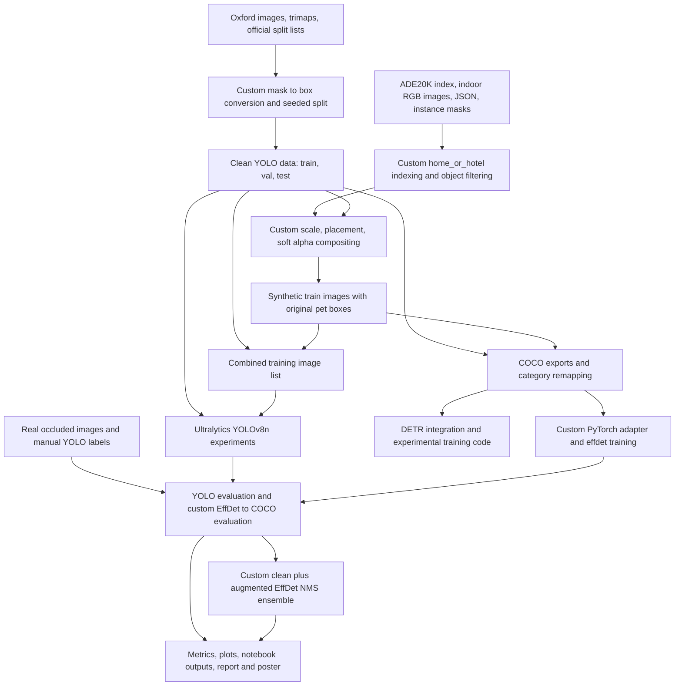

# Project Name

> Transfer source: `Resume_Builder/evidence/occluded-pet-detector/PROJECT_ANALYSIS.md` at revision `0793f96beae0a8db7b3890dc70c9383d4c87b2cf`; copied 2026-10-15. Source class: **supporting-analysis**. Privacy edits are listed in `catalog.json`. This is a preserved historical investigation, not a new test run or an independently confirmed career record. Statements about the investigation, workspace, file creation, or validation describe that original analysis. Internal code/data paths refer to the investigated project and are not files supplied in this collection.

**Occluded Pet Detector** — the name used in `CPSC599_26_Project_Report.pdf`. The poster uses **Occluded Pet detection in Domestic Environments**.

This is a technical record of the repository as supplied, investigated on 2026-10-09. Original project implementation is attributed to Parmeet Virdi under the supplied sole-developer ownership statement. Public datasets, pretrained architectures, library internals, generated experiment artifacts, and the ACM publishing template are distinguished from original implementation throughout.

## Evidence conventions and investigation method

- **Verified implementation:** behavior directly visible in source code or notebook cell source. This establishes what the implementation does when the relevant code executes; it does not establish that every cell executed successfully.
- **Verified artifact or recorded result:** file contents, archive contents, notebook output, directory counts, or a measurement calculated from those artifacts. Saved notebook results are historical evidence, not results reproduced during this investigation.
- **Documented claim:** a statement in the report, proposal, poster, or attribution material. Its presence is verified, but its underlying assertion may require corroboration. Contradictions are retained explicitly.
- **Interpretation:** a technical explanation supported by the implementation or observations but not established as a measured causal conclusion.
- **Unknown:** information not sufficiently established by the supplied files.

Evidence references below are relative to the repository root. Python references name functions and, where helpful, line numbers. Notebook cell indices are **zero-based positions in the notebook's `cells` array**, not the displayed execution counter. PDF page numbers are one-based. An archive reference of the form `archive.zip :: member/path` refers to contents inspected directly in memory, without extraction into the repository.

The investigation inspected the original Python files, all eight notebook sources and their stored outputs, experiment configuration and CSV artifacts, COCO JSON data, dataset directory structure and counts, archive manifests and selected archive contents, report and proposal PDFs, poster PDF and PowerPoint slide XML, attribution records, and the supplied document template. Dataset archives provided access to configuration and annotation content as well as an inventory of the large data subtree. Some direct filesystem reads in the large extracted data tree and some YAML files did not complete promptly; relevant archived counterparts and notebook-generated configuration text were inspected instead. Archive contents are identified explicitly where used, rather than assumed to be identical to every extracted counterpart.

Read-only structural checks included annotation counts, ID consistency, split membership, filename overlap, normalized YOLO label values, and checkpoint/archive byte comparisons. Project training, evaluation, package installation, formatters, linters, and migrations were not executed. No model or dataset pickle was deserialized; checkpoint structure was examined using ZIP metadata and static pickle opcode inspection. Existing source files were not changed. `PROJECT_ANALYSIS.md` is the sole intended repository change.

# Overview

The project is an offline computer vision experimentation pipeline for detecting cats and dogs when household objects obscure part of the animal. It compares models trained on clean Oxford-IIIT Pet images with models trained using clean images plus synthetic occlusions made from segmented ADE20K objects. A separate collection of naturally occluded pet photographs supports evaluation of transfer from synthetic augmentation to real occlusion.

The implemented detection task has **one foreground class, `pet`**. Cats, dogs, and their breeds are pooled for detection. The original Oxford breed/species annotations remain in the raw dataset, but the detector labels do not distinguish species or breed. The proposal's planned two-class cat/dog task differs from the delivered one-class task.

The repository demonstrates dataset conversion, indoor-scene selection, object-mask extraction and filtering, image compositing, training configuration, pretrained model adaptation, custom PyTorch data adapters and loops, COCO evaluation, a two-model EfficientDet ensemble, diagnostic visualization, result plotting, and academic reporting. It does not demonstrate a deployed pet-monitoring application, streaming camera service, web application, or production inference API.

Two model families have corroborated real-occlusion results: **YOLOv8n** and **EfficientDet-D0**. **DETR with a ResNet-50 backbone** was explored in code and described in the academic deliverables, but its training and final evaluation provenance is substantially less complete.

The saved real-occlusion evaluations show that synthetic augmentation did not produce a uniform benefit: clean-trained YOLO performs better than augmented YOLO on that collection, while augmented EfficientDet performs modestly better than clean EfficientDet. The EfficientDet ensemble produces more candidate detections but has lower AP than the augmented EfficientDet model. These are observations from the recorded experiments; broad architectural or real-world robustness claims require additional evidence.

Primary evidence: `Project materials/pet-occlusion.py`; `Project materials/pet-occlusion copy.py`; `Project materials/CPSC599PROJECT/notebooks/pet_occlusion.py`; `Project materials/Real_Occluded/real_occ_test.ipynb`; `Project materials/Real_Occluded/real_occ_efficinet.ipynb`; `CPSC599_26_Project_Report.pdf`, pages 1–6.

# Repository Scope

## Major areas

| Area | Contents and relationship to the project |
|---|---|
| Root | Final seven-page report PDF and four-page proposal PDF. No root application entry point or dependency manifest was identified. |
| `Project materials/CPSC599PROJECT/notebooks/` | Local data exploration and preprocessing notebook, its Python export, and a `yolov8n.pt` pretrained checkpoint. Implements Oxford trimap conversion and ADE20K indoor-scene indexing. |
| `Project materials/CPSC599PROJECT/data/oxford_pets/` | Downloaded Oxford images, trimaps, VOC XML head annotations, and official split lists. These are external dataset materials. |
| `Project materials/CPSC599PROJECT/data/data_oxford_yolo/` | Prepared clean dataset in image/label train, validation, and test directories, plus dataset YAML. |
| `Project materials/CPSC599PROJECT/data/ADE20K_2021_17_01/` | ADE20K index files, object names, image/annotation/mask tree, and project-created indoor-scene CSV/text indices. |
| `Project materials/CPSC599PROJECT/runs/baseline/` | Saved baseline YOLO training output, `args.yaml`, `results.csv`, weights, plots, labeled/predicted image grids, and detection validation output. |
| `Project materials/pet-occlusion.py` and `.ipynb` | Kaggle-oriented augmentation and combined-data YOLO training/evaluation workflow. The notebook retains completed run output. |
| `Project materials/pet-occlusion copy.py` and `.ipynb` | Expanded experiment source with COCO export/merge sketches, DETR adapters and training/evaluation sketches, category remapping, and EfficientDet data/training code. The 77-cell notebook has no non-null execution counters or saved executed outputs. |
| `Project materials/project files/` | Earlier baseline and augmentation notebook/export variants; archived runs and clean test evaluations; extracted augmented data; `train_combined.txt`; original Oxford image/annotation tarballs; and a run directory explicitly named `oxford_clean_plus_occ_yolov8n - fake`. |
| `Project materials/project files/data/` | Persisted synthetic dataset: 3,000 JPEGs and 3,000 YOLO label files. |
| `Project materials/kaggle/working/coco_annotations/` | Nine COCO instance JSON files: five logical dataset views and four zero-based category variants. The same nine JSON files are retained in `coco_zero_annotations.zip`. |
| `Project materials/Real_Occluded/` | Real-occlusion test images and labels, attribution/source records, clean/augmented YOLO and EfficientDet weights, two evaluation notebooks, test configuration, label cache, and saved YOLO `val5`/`val6` output. |
| `Project materials/untitled folder/` | `analysis.py`, clean/augmented YOLO CSV inputs, and four paper figures. |
| `Project materials/CPSC599Poster.pptx` and `.pdf` | Editable one-slide research poster and PDF export. Slide XML includes eleven embedded media assets. |
| `Project materials/Deliverables_Parmeet_Virdi_30142155.zip` | Packaged report, poster, and `CPSC599Presentation.mp4`, plus directory/desktop metadata. |
| `Project materials/Project Template/` and `project/Project Template/` | Duplicated ACM template files, bibliography styles/data, example LaTeX, logos/images, and user guide; corresponding ZIPs are also retained. These are vendor materials. |
| `project/Project proposal/` | Proposal PDF, assignment specification, and a zero-byte `proposal.tex`. The empty TeX file does not preserve proposal source. |
| `Project materials/part_run.pt` | Additional EfficientDet-like checkpoint with detection-head keys. Its exact experiment/epoch purpose is not established. |

The directory name `kaggle ` under `Project materials/project files/` includes a trailing space and is distinct from `kaggle`; `kaggle occ` is also present. These retain working/run directory remnants. Their existence does not establish additional completed experiments.

## Source inventory and variants

Six project Python files were identified outside vendor/data materials:

| File | Physical lines | Role |
|---|---:|---|
| `Project materials/CPSC599PROJECT/notebooks/pet_occlusion.py` | 921 | Local exploration, ADE index preparation, Oxford conversion, sanity checks. |
| `Project materials/project files/pet-occlusion.py` | 633 | Baseline Kaggle YOLO training and clean-test evaluation export. |
| `Project materials/project files/pet-occlusion copy 2.py` | 1,199 | Augmentation workflow variant; its training call still references the clean dataset YAML. |
| `Project materials/pet-occlusion.py` | 1,230 | Combined-data YOLO workflow with corrected training data configuration, archive packaging, and clean-test evaluation. |
| `Project materials/pet-occlusion copy.py` | 2,317 | Extended experiment/export/adaptation/training source, including large commented sections. |
| `Project materials/untitled folder/analysis.py` | 95 | Publication figure generation. |

These counts include notebook export markers, comments, blank lines, and duplicate code. They are a file inventory, not a measure of unique original implementation effort.

Eight notebook files were inspected:

| Notebook | Total cells | Code cells | Cells with non-null execution counters |
|---|---:|---:|---:|
| `Project materials/CPSC599PROJECT/notebooks/pet_occlusion.ipynb` | 29 | 25 | 0 |
| `Project materials/project files/pet-occlusion.ipynb` | 28 | 25 | 24 |
| `Project materials/project files/pet-occlusion copy.ipynb` | 36 | 33 | 32 |
| `Project materials/project files/pet-occlusion copy 2.ipynb` | 42 | 39 | 20 |
| `Project materials/pet-occlusion.ipynb` | 45 | 42 | 41 |
| `Project materials/pet-occlusion copy.ipynb` | 77 | 74 | 0 |
| `Project materials/Real_Occluded/real_occ_test.ipynb` | 10 | 10 | 9 |
| `Project materials/Real_Occluded/real_occ_efficinet.ipynb` | 3 | 3 | 2 |

Counts were calculated directly from notebook JSON. Execution counters indicate retained execution metadata, not the number of distinct experiments or proof that current source reproduces old outputs. No notebook `error` output blocks were found in these eight files; warnings and shell-command failures are nevertheless present in text output.

## Large data and archive inventory

- `Project materials/CPSC599PROJECT/data.zip` contains **293,363 ZIP entries**, of which **286,624 are file entries**. Its two top-level data areas are prepared Oxford YOLO data and ADE20K; the raw Oxford image tree is not included in this particular archive.
- That archive contains **6,641 ADE JSON files**, matching the selected indoor train/validation index counts of 6,118 + 523. It also contains large numbers of semantic and instance mask PNGs. Mask counts are not pet-detection examples or custom source files.
- `Project materials/project files/data.zip` contains **6,000 files**, corresponding to 3,000 synthetic images and 3,000 labels, plus directory entries.
- `Project materials/YOLO_OCC.zip` contains **74 label files**, `train.txt`, and `data.yaml`; despite its name, it is an annotation/configuration export for the real image collection, not the 3,000-image synthetic training dataset. Its paths place labels under `labels/train/images/`; this export layout differs from the flattened evaluation layout.
- `Project materials/Real_Occluded/RAW/images.zip` contains **74 image files** and an image directory entry.
- `Project materials/coco_annotations.zip` contains five instance JSON datasets plus a directory entry; `coco_zero_annotations.zip` contains those five and four zero-based variants plus a directory entry.
- `Project materials/project files/annotations.tar.gz` contains the external Oxford annotation distribution, including split lists, head-box XML, and trimap materials. `images.tar.gz` is also retained.
- Baseline and augmented run ZIPs preserve configuration, CSV results, weights, training/validation grids, and curves. Separate baseline/augmented test ZIPs preserve generated evaluation figures.

ZIP file counts come from manifests, not extraction or reconstructed directory estimates. No claim is made that every extracted ADE20K image/mask byte was opened, or that all duplicate archives represent distinct work.

# Contributions

## Original project implementation and experimental work

Under the supplied sole-developer attribution, the following project-specific work is supported by source and artifacts:

1. **Defined an experimental comparison for pet detection under occlusion.** Established clean training, synthetic augmentation, clean validation/test, and separate real-occlusion testing; selected three pretrained model families. Evidence: report sections 2–5; proposal; training/evaluation source.
2. **Explored Oxford annotations and ADE20K image/segmentation metadata.** Implemented split-list parsing, mask overlays, side-by-side image display, ADE semantic-mask decoding, instance-ID reindexing, object-presence inspection, and qualitative dataset inspection. Evidence: local `pet_occlusion.py`, lines 93–609.
3. **Prepared a one-class Oxford detection dataset from segmentation masks.** Extracted pet-mask bounds, added bounded padding, normalized boxes, copied split images, wrote YOLO label files and YAML, and generated processing summaries. Evidence: `trimap_to_bbox`, `bbox_to_yolo`, `copy_split`, `build_yolo_dataset`.
4. **Created an indoor ADE20K object-source subset.** Filtered index paths to `home_or_hotel`, separated training and validation, recorded image/segmentation availability, and stored CSV/text indices. Evidence: local export lines 421–497; retained indices and archive contents.
5. **Implemented synthetic object occlusion.** Used instance masks to extract complete objects, excluded structural/background object names, filtered area/aspect ratio, calculated object scale relative to pet boxes, chose randomized placement, and composited with softened alpha. Evidence: `sample_good_occluder_from_json`, `compute_scale`, `pick_overlap_position`, `make_soft_alpha`, `paste_occluder`.
6. **Implemented persistent synthetic dataset generation.** Produced distinct image filenames and copied original bounding-box labels to retain pet supervision; stored the generated dataset for reuse. Evidence: `generate_occluded_train`; 3,000-image/label dataset; COCO synthetic export.
7. **Configured clean and combined-data YOLO fine-tuning and evaluation.** Rewrote local dataset paths for Kaggle, generated a combined absolute image manifest, selected pretrained YOLOv8n, configured GPU training, loaded the best checkpoint, and evaluated clean and real test datasets. Evidence: baseline export; main notebook; real YOLO notebook.
8. **Preserved experiment provenance and outputs.** Packaged model runs, retained CSVs/configuration/checkpoints, and stored library-generated curves, confusion matrices, and prediction grids. Packaging/orchestration is project work; library rendering and automatic checkpoint mechanics are not custom implementations.
9. **Wrote COCO export and merge implementations retained as commented experiment code.** Converted YOLO labels into pixel boxes, built COCO images/annotations/categories, and reassigned IDs across merged datasets. Resulting JSON artifacts corroborate the schemas/counts, although execution of the current commented exporter cannot be established. Evidence: extended export lines 1228–1503 and saved COCO files.
10. **Adapted COCO data to DETR.** Added image lookup across roots, per-image annotation indexing, Hugging Face processor integration, padding/collation, one-class model configuration, training-loop sketches, evaluation sketches, visual comparisons, and save-pretrained calls. Evidence: extended export lines 1504–2063. Complete successful DETR fine-tuning is documented but not independently traceable to retained execution logs/checkpoints.
11. **Adapted data and training to EfficientDet-D0.** Remapped foreground categories to one-based IDs, implemented square resize/normalization and box scaling, padded variable-length targets, configured loaders and AdamW, wrote train/validation loops, and saved the base model when validation loss improved. Evidence: extended export lines 2068–2310.
12. **Collected and prepared the real occlusion evaluation dataset.** The report describes collecting images and manually drawing visible-region boxes. The supplied images, 74 annotation files, 90 box records, source links, and evaluation outputs corroborate the delivered dataset. Annotation software, individual annotation sessions, and species balance are not independently recorded.
13. **Implemented real-occlusion evaluation for EfficientDet.** Converted labels to in-memory COCO ground truth, normalized input consistently with the training adapter, loaded and diagnosed checkpoints, decoded/scaled/clamped predictions, filtered scores, ran COCO evaluation, and compared clean/augmented checkpoints. Evidence: `real_occ_efficinet.ipynb`, cell 0.
14. **Implemented a two-checkpoint detection ensemble.** Grouped predictions by image, calculated IoU, applied custom greedy NMS, and evaluated the merged output. Evidence: `iou_xyxy`, `nms_xyxy`, `ensemble_merge_nms` in the same cell.
15. **Implemented diagnostic output comparison.** Drew ground-truth and predicted boxes/confidences across clean, augmented, and ensemble panels, preserving correct image-ID lookup after random sampling. Evidence: real EfficientDet notebook cell 1.
16. **Created paper figures and research deliverables.** Generated four 300-DPI plots, wrote a technical report and proposal, prepared an editable poster/PDF, and packaged a presentation video. Evidence: `analysis.py`; `paper_figures/`; root PDFs; poster files; deliverables archive.
17. **Addressed operational experiment problems in code and workflow.** Added explicit missing-path/label checks, rewrote environment-specific paths, preserved generated data to avoid repeated synthesis, distinguished classifier/detection checkpoints, handled alternate checkpoint wrappers and `module.` keys, and retained a corrected combined-training YAML selection. These mechanisms are supported; they do not establish a complete incident history.

## Functionality supplied by frameworks, external code, or generated artifacts

- **Ultralytics supplies** YOLO model definitions, pretrained assets, training engine, automatic optimizer selection, default augmentation, automatic mixed precision, automatic best/last checkpoints, cache management, automatic JPEG repair, metric computation, built-in prediction postprocessing, confusion matrices, and many plots. The project configures/invokes these facilities.
- **PyTorch supplies** tensors, autograd, modules, optimizer implementation, device execution, dataset/loader framework, and serialization. Custom adapters, batch assembly, training-loop orchestration, and checkpoint-selection condition are project code.
- **Hugging Face Transformers supplies** DETR/ResNet model implementation, pretrained loading, processor normalization/resizing/padding behavior, model loss, object-detection postprocessing, and save-pretrained serialization. Project integration and labels/data mapping are custom.
- **`effdet`/`timm` supply** EfficientDet architecture, backbone, loss bench, prediction decoding, and pretrained model integration. No custom EfficientDet backbone or BiFPN implementation is present.
- **`pycocotools` supplies** COCO indexing/evaluation and AP/AR calculations. Building ground truth and detections, invoking evaluation, and extracting statistics are project code.
- **OpenCV, Pillow, NumPy, and Matplotlib supply** primitive image loading/resizing, dilation/blur, array computation, and drawing. Object-selection/compositing logic and figure composition are project work.
- **Oxford-IIIT and ADE20K** images/annotations/index metadata are third-party datasets. Public Flickr images remain third-party works. Preparing derived pet boxes, dataset indices, synthetic combinations, and manual real-image annotations is distinguishable from creating the source photographs.
- **ACM templates/styles/sample bibliography** are external publishing material. Their README changelog is not this project's development history. Generic sample authors, DOI placeholders, and publication dates are not project authorship/publication evidence.
- **Python exports and notebook metadata**, label caches, model-generated figures, desktop `.DS_Store` files, and archive directory entries are generated materials. Their quantity is not unique custom feature count.

# Architecture

## System architecture

The project uses file-based batch processing and interactive notebooks. There is no demonstrated frontend/backend split, application database, network service mesh, or persistent job scheduler.

The diagram describes observed module relationships. It does not imply that every retained experimental branch is a completed end-to-end run.

## Execution locations and boundaries

- Local preparation resolves `ROOT = Path("..").resolve()` in the original notebook export and assumes notebook-relative data directories.
- Kaggle code uses `/kaggle/input/cpsc599-26project/data` for prepared Oxford/ADE inputs and `/kaggle/working` for generated YAML, manifests, images, runs, and archives.
- Synthetic training data is reused from `/kaggle/input/cpsc599-26occluded-pets/data`.
- COCO adapters expect `/kaggle/input/coco-zero-annotations/kaggle/working/coco_annotations`.
- Several early cells offer a `Path.cwd()/data` fallback; later cells retain hardcoded Kaggle paths, so the fallback is incomplete.
- Real YOLO evaluation resolves paths from the current directory, while the EfficientDet evaluation hardcodes `[local path omitted]`.
- Saved local evaluation output identifies a CPU environment; saved Kaggle training output identifies a Tesla P100 GPU.

This is a notebook workflow with manual cell/configuration choices and persisted artifacts, not a single portable packaged pipeline.

## Model architecture choices

- **YOLOv8n:** instantiated as `YOLO("yolov8n.pt")`, configured for detection and a single pet class. The recorded fused model summary reports 72 layers, 3,005,843 parameters, and 8.1 GFLOPs. Those model attributes are framework-reported, not measurements of custom architecture code.
- **EfficientDet-D0:** `create_model("tf_efficientdet_d0", pretrained=True, num_classes=1)` for training; `DetBenchTrain` supplies losses. Real evaluation reconstructs a one-class D0 model with `pretrained=False` and wraps it in `DetBenchPredict` after loading saved state.
- **DETR:** `DetrForObjectDetection.from_pretrained("facebook/detr-resnet-50", num_labels=1, ignore_mismatched_sizes=True)` with `{0: "pet"}` label maps in the active adapter. Earlier commented code used a one-based label map. Single-class output-head adaptation is performed through the library API.

The report says the project intentionally retained standard architectures to isolate data augmentation. The code supports use of library models rather than new detector architectures. Output-class configuration and pretrained head replacement are nevertheless real integration steps.

# Technologies

| Group | Demonstrated technologies | Evidence and limits |
|---|---|---|
| Languages | Python; shell commands embedded in IPython; LaTeX/BibTeX document materials | Six project `.py` files, notebook `!pip`/`!zip` commands, report rendered using ACM conventions, supplied `.tex`/`.bib` templates. The final report's editable LaTeX source is not present. |
| Deep learning | PyTorch; torchvision; Ultralytics YOLO; Hugging Face Transformers; `effdet`; `timm` | Training/evaluation imports and calls. Some DETR code is commented or in unexecuted cells. |
| Numerical/image processing | NumPy; OpenCV; Pillow | Mask decoding, object masks, resizing, alpha synthesis, coordinate transforms. |
| Analysis/visualization | Matplotlib; pandas; tqdm | Custom display helpers, publication CSV plots, progress bars. |
| Annotation/evaluation formats | YOLO text boxes; COCO instance JSON; `pycocotools`; Oxford trimaps; PASCAL VOC XML | Prepared labels/exporters/evaluation; XML head annotations are present as raw data but are not used by the trimap-box builder. |
| Interactive/runtime tooling | Jupyter/IPython; Kaggle notebooks; CUDA-enabled training; local Python environment `vision_A2` | Notebook metadata, `get_ipython()` export calls, recorded environment output. |
| Data/storage tools | Python `csv`, `json`, `pickle`, `pathlib`, `shutil`, ZIP/tar packaging; `.pt` checkpoint serialization | Persistent artifact formats and code paths. Pickle use is limited to dataset/checkpoint loading, not a database engine. |
| Academic deliverables | PDF, PowerPoint Open XML `.pptx`, MP4, ACM `acmart` class and bibliography styles | Supplied deliverables/template. Their presence does not establish publication or production deployment. |

**Imported but not demonstrated as used in meaningful implementation:** Albumentations and scikit-learn `precision_score`/`recall_score` appear in exports, but the inspected detection metrics use Ultralytics or COCO evaluation and the synthetic augmentation uses custom OpenCV/NumPy operations. They should not be credited as implemented augmentation or evaluation integrations merely because they are imported.

**Recorded versions:** baseline Kaggle output reports Ultralytics 8.3.239, Python 3.12.12, PyTorch 2.8.0+cu126; main augmented run reports Ultralytics 8.3.240 with the same Python/PyTorch versions. Local YOLO output reports Ultralytics 8.3.237, Python 3.10.19, PyTorch 2.2.2, and Intel Core i5-8257U CPU execution. Local installation output records `effdet` 0.4.1, `timm` 1.0.22, and `pycocotools` 2.0.11. These are historical environment observations, not a locked environment definition or verified current dependency set.

No project dependency lockfile, requirements file, environment YAML, `pyproject.toml`, npm manifest, Dockerfile, or project CI workflow was identified in the inspected source/configuration areas.

# Features

## Dataset exploration and preparation

- Parses Oxford image IDs while ignoring empty/comment lines and discarding breed/species columns for detection preprocessing.
- Displays any number of images side by side, accepts per-image titles and colormaps, and returns without plotting when no image is supplied.
- Creates image/mask overlays with configurable opacity. `make_overlay` normalizes mask values using a denominator with `1e-6` and colors them with the Matplotlib jet map.
- Inspects ADE index keys, object/part counts, scene names, and frequent object classes.
- Decodes ADE segmentation color channels into class masks and reindexes blue-channel instance IDs.
- Produces train/validation CSV inventories for indoor scenes and reads availability flags back as integers.
- Converts Oxford foreground regions to padded, normalized detection boxes and prepares three named splits.
- Checks image/label coverage, empty labels, class frequencies, and bounding-box visual alignment.

## Synthetic augmentation

- Extracts non-part ADE object instances from JSON and associated instance masks.
- Rejects selected structural/background categories and objects that are too small or have extreme aspect ratios.
- Crops object RGB/mask to occupied pixel bounds and zeros background RGB outside the mask.
- Scales object area relative to the pet bounding rectangle, randomizes placement, and clips at image edges.
- Dilates/blurs masks to soften boundaries and blends at fixed opacity.
- Writes synthetic image/label pairs with unchanged full pet boxes.
- Reuses saved generated data through Kaggle input rather than requiring regeneration on every training run.
- Combines clean/synthetic image paths in a training manifest, keeping clean validation/test data separate.

## Training and comparisons

- Configures pretrained clean and augmented YOLOv8n runs.
- Keeps training/validation losses, detection metrics, learning-rate traces, and framework-generated diagnostics.
- Provides COCO schemas/category variants for cross-model training adapters.
- Implements DETR processor/dataset/batch integration and experimental fine-tuning/evaluation code.
- Implements EfficientDet tensor preparation, target padding, train/validation loops, and best-loss checkpoint selection.
- Runs clean and augmented real-image evaluation using the same annotated image collection.
- Evaluates a clean/augmented EfficientDet ensemble and renders three-column visual comparisons.
- Generates publication plots and packages academic deliverables.

# Backend / APIs

There is **no identified HTTP/RPC backend, application API endpoint, authentication service, authorization layer, or scheduled background worker**. Calls such as `YOLO.train`, `YOLO.val`, `create_model`, `processor.post_process_object_detection`, and `COCOeval` are library APIs used within notebooks, not project web endpoints.

The meaningful processing modules are dataset preparation, augmentation, training, evaluation, plotting, and artifact packaging. They run in notebook cells or exported scripts. Local Python functions and dataset classes form the project's internal programmatic interfaces.

No inference server, remote prediction endpoint, camera acquisition interface, webhook, or recovery endpoint is present. Potential indoor monitoring/robotics applications are discussed in the report/proposal, rather than delivered as backend functionality.

# Frontend

No browser frontend, application pages, component library, client routing, state store, or web forms were identified.

The human-facing interfaces are Jupyter notebook cells, console/progress output, Matplotlib image grids, prediction figures, the poster, and the written report. These provide experiment inspection rather than an application user workflow. Custom plotting helpers are reusable within the experiment source, but repeated notebook copies are not a centralized UI component system.

## Visualization details

- Clean-label visual inspection uses a 4×5 axes grid. The local preprocessing export sets `num_samples = 50` despite a 20-axis grid; iteration through `zip(axes, sel_imgs)` displays at most 20 images. Later exports set the requested sample count to 20.
- Synthetic demonstration shows the original image, augmented image, object RGB crop, and mask with an occluder-name/ratio title.
- DETR visual comparison draws GT green, predictions red, filters at confidence 0.2 by default, sorts scores descending, and displays at most five predicted boxes per image. Its final call requests ten images.
- EfficientDet real-image comparison samples eight images using seed 10 and visualization confidence 0.25; eight rows × three columns produce 24 panels. Ground truth is green and predictions red, with per-box score text.
- `show_examples` correctly uses `img_paths.index(p) + 1` for COCO image IDs after random sampling. A preceding `img_id = r + 1` line is immediately overwritten, and a comment identifies it as incorrect for sampled order.

Evidence: original preprocessing export lines 874–911; augmentation display section; extended export `visualize_detr_vs_gt`; real EfficientDet notebook cell 1.

# Database / Data Engineering

## Storage model

No relational/document database service, ORM models, database migrations, transactions, or database indexes were found. The data engineering is filesystem- and annotation-based.

Logical entities include image records, pet bounding boxes, dataset splits, ADE object instances, object masks, model checkpoints, and per-epoch metric rows. Relationships are carried through filename stems, image IDs, relative paths, and annotation `image_id` values.

## Oxford preparation pipeline

Source: `Project materials/CPSC599PROJECT/notebooks/pet_occlusion.py`, lines 609–803.

1. Reads official `trainval.txt` and `test.txt`; ignores comment/empty lines and retains the first token as image ID.
2. Seeds Python's random generator with **42**, shuffles trainval IDs, and takes `max(1, int(len(trainval_ids) * 0.1))` as validation IDs.
3. For each ID, requires a JPEG and trimap PNG. Missing files and empty pet masks are warned about and skipped.
4. Converts the trimap to grayscale and selects **value 1 only**, through `TRIMAP_PET_VALUES = (1)`. In Python this expression is an integer, not a singleton tuple, but `np.isin` receives it as the selected value.
5. Finds min/max occupied coordinates; calculates inclusive widths/heights using `+1`; adds rounded **5% padding** independently in each dimension; clamps bounds to `[0, W-1]` and `[0, H-1]`.
6. Converts to YOLO center/width/height normalized by original image size, clamps all four normalized values into `[0,1]`, and writes six decimal places with class **0**.
7. Copies images into `images/{train,val,test}` and writes labels into matching `labels/{train,val,test}` directories.
8. Writes YAML with a single `pet` class and prints copied/skipped counts and output paths.

**Comment discrepancy:** the code comments call trimap values 2 and 3 border/background, and the function docstring says it uses pet plus border labels 1 and 2. The external Oxford annotation README says 1=foreground, 2=background, 3=not classified. The actual code uses value 1 only; its operation is unambiguous despite those descriptions.

**Source versus prepared population:** the raw image directory contains **7,390 `.jpg` files**, three `.mat` files, and 7,390 trimap PNGs; official annotated `list.txt` contains **7,349 IDs**. The prepared detector splits sum to 7,349. Raw file population should not be substituted for the annotated/prepared population.

The raw VOC XML files describe head ROIs according to the external README. The project builder uses segmentation-derived pet extent instead of those head boxes. This is a meaningful label design choice supported by the code.

## ADE20K indexing and mask decoding

Sources: local export lines 328–609; main export `loadAde20K`, `read_csv_rows`, and `sample_good_occluder_from_json`; retained ADE indices.

- Loads the external `index_ade20k.pkl` dictionary, whose stored descriptions/output reference **27,574 indexed images**. This is the broad external index population, not the number used for training synthesis.
- Filters folder strings to contain `home_or_hotel`, then identifies `training` or `validation` in those paths.
- Writes rows with `idx`, `split`, `scene_group`, `folder`, `filename`, `image_relpath`, `seg_relpath`, `image_exists`, and `seg_exists`.
- Retained CSVs contain **6,118 training rows** and **523 validation rows**, all marked with image/segmentation availability equal to 1. Those flags record generation-time availability; they do not guarantee current availability at the saved absolute location.
- Text index lists contain the corresponding integer index selections. Object synthesis draws from `ADE_TRAIN_IDX`; validation indices are explored but are not the occluder sampling pool.
- Semantic class decoding is `(R // 10) * 256 + G`. Blue-channel values are passed to `np.unique(..., return_inverse=True)` for contiguous instance IDs.
- `loadAde20K` deliberately returns empty part-class/part-instance/object/part fields; it is a minimal compatibility loader, not a complete reimplementation of ADE's utilities.
- Extracting occluders uses object-level `annotation.object` JSON, `parts.part_level`, and an `instance_mask` relative path, rather than the semantic display mask alone.

## Synthetic generation algorithm and supervision

Sources: main export lines 631–1084.

- Reads `objects.txt`, taking the first tab-delimited column and excluding the header.
- `is_bad_object` lowercases names, extracts alphabetic tokens, and rejects names if tokens intersect the structural exclusion set or contain specified two-word combinations. Examples include wall, floor, ceiling, sky, road, windows, doors, stairs, railings, curtains, frames, lights, fireplace, mirror, painting, and countertop-related terms. This is a hand-written heuristic, not a learned object suitability classifier.
- Saved output reports **1,599 object-name rows** and **125 excluded names** in that pass. The effective selection filter checks exact object names against the generated `BAD_OBJECTS` set.
- Each `sample_good_occluder_from_json(max_tries=80)` attempt chooses a random ADE training image, opens RGB and JSON, shuffles its object list, and skips parts, excluded categories, missing masks, empty masks, and unacceptable shapes.
- Requires masked object area / source image area ≥ **0.02**; crop aspect ratio must fall within **0.15–4.0**.
- Returns masked RGB crop, binary cropped mask, and object name, or `None` after 80 image-selection attempts.
- Computes scale as `sqrt(r * pet_bbox_area / occluder_mask_area)`, guarding both areas with a minimum of 1. The function's default clamp is **0.25–1.6**; the actual demo/generation call passes **0.25–1.5**.
- Draws requested area ratio `r` uniformly from **0.20–0.65**. This is a target relative to the pet bounding rectangle before clipping/placement; no achieved foreground-occlusion percentage is computed or persisted.
- Forces resized object dimensions to at least **20 pixels**, resizes RGB linearly and binary masks with nearest-neighbor interpolation.
- Chooses an occluder rectangle center within the pet box, allowing limited out-of-image placement; clips compositing to actual image bounds. Rectangle overlap does not prove the occupied object-mask pixels obscure pet foreground.
- Builds alpha by converting mask values to 0/255, dilating with a **4×4** kernel, then Gaussian-blurring with a **9×9** kernel when `feather=4`; multiplies by **0.95 opacity**.
- Blends `base * (1-alpha) + occluder * alpha` within the cropped ROI, clips to `[0,255]`, casts to `uint8`, and modifies the passed image array.
- Generator target `NUM_OCC` is **3,000**. It walks sorted train images with an index modulo the list length and continues until `made` reaches the requested count.
- Filenames follow `<original_stem>_occ_<six_digit_counter>.jpg`; labels are copied unchanged from the clean source image.

Keeping the original pet box preserves the original full pet extent as training supervision even when the object is partly hidden. The report describes real annotations around visible extent. **Interpretation:** this difference in annotation targets may contribute to mismatched synthetic/real supervision, but no experiment isolates its effect.

Saved COCO filenames show **3,000 distinct clean source stems** for the 3,000 synthetic images. All are members of the clean training set; none are validation or clean-test filenames. This was verified from filename membership, not semantic image deduplication.

The earlier `Project materials/project files/pet-occlusion copy.ipynb` actually calls `generate_occluded_train()` in cell 32 and retains completion output: **3,000/3,000 images**, elapsed **04:09**, approximately **12.00 images/second** as displayed by tqdm. Cell 33 visualizes five saved examples, and cell 34 records packaging `data.zip`. The later main notebook/export comments out generation and reuses the saved Kaggle dataset. This distinguishes the recorded generation run from subsequent dataset reuse; the displayed generation rate is one historical run, not a controlled performance benchmark.

## COCO schemas, transformations, and integrity

Sources: extended export lines 1228–1503, 1790–1833, 2068–2101; `Project materials/kaggle/working/coco_annotations/*.json`; COCO archive members.

Image records contain `id`, `file_name`, `width`, and `height`. Annotation records contain `id`, `image_id`, `category_id`, pixel `bbox=[x,y,width,height]`, `area`, and `iscrowd`. The original category is `{id: 1, name: "pet", supercategory: "animal"}`; zero-based variants use `{id: 0, name: "pet"}`.

The commented exporter reads image dimensions, skips images without labels, converts normalized YOLO boxes through the integer-valued helper, clamps bounds, forces width/height to at least 1, assigns image/annotation IDs from 1, and writes JSON. It ignores the original YOLO class value and uses the configured single COCO category.

The commented merge implementation remaps each input dataset's old image IDs through an `old_to_new` dictionary, assigns fresh annotation IDs, and preserves category/box information. It assumes the category schemas match; it does not implement schema negotiation or filename collision resolution.

| Logical COCO view | Images | Annotations | Category ID |
|---|---:|---:|---:|
| `instances_train_clean.json` | 3,312 | 3,312 | 1 |
| `instances_val_clean.json` | 368 | 368 | 1 |
| `instances_test_clean.json` | 3,669 | 3,669 | 1 |
| `instances_train_occ_only.json` | 3,000 | 3,000 | 1 |
| `instances_train_clean_plus_occ.json` | 6,312 | 6,312 | 1 |
| Four `_zero.json` variants of clean train, validation, test, combined train | Same as corresponding original | Same as corresponding original | 0 |

The zero-based remapping sketch rewrites all annotation category IDs and the categories array. The active EfficientDet remapper reverses the convention to category 1 for clean train, combined train, validation, and test, writing `_eff.json` files under `/kaggle/working/coco_annotations_eff`. Those generated `_eff.json` outputs were not found among the supplied retained annotation files.

Read-only investigation checks established:

- Every retained COCO view has unique image IDs and unique annotation IDs, with **zero orphan annotation references** within its file.
- Clean train/validation/test filename intersections are all empty.
- Combined train filenames equal the union of clean and synthetic train filenames.
- All nine extracted COCO JSON files are byte-identical to their members in `coco_zero_annotations.zip`.
- Prepared clean YOLO archive contains **7,349 label files and 7,349 boxes**; each inspected label line has five fields, class 0, and normalized values within `[0,1]`.
- The real annotation export contains **74 label files and 90 boxes**, all class 0 with five fields and normalized values within `[0,1]`.

These are structural checks. They do not establish visual annotation correctness, achieved occlusion severity, independence of near-duplicate photographs, or equality of model-specific coordinate conventions.

## Real-image annotations

The delivered evaluation layout has 74 JPEG filenames and matching 74 text labels. Several images contain multiple boxes, yielding 90 instances. The report says boxes surround visible animal regions and may span across an intervening object when separated visible parts belong to one animal.

The report describes an even cat/dog split; the labels collapse all animals into one category and do not encode species. The supplied attribution list and image filenames do not independently establish that balance. The report also says the collection combines personal and public images; attribution text broadly describes all images as Flickr sourced, while personal-style `IMG_*` filenames are present. Source/license coverage is discussed under uncertainties.

# Training, Evaluation, and Internal Processing Interfaces

## YOLO baseline and augmented runs

Sources: baseline export lines 526–625; main export lines 1096–1220; baseline notebook cell 22; main notebook cells 35–42; archived run `args.yaml` and `results.csv`.

Shared explicit training parameters:

- `task="detect"`, `imgsz=640`, **50 epochs**, **batch 16**, **4 workers**, **GPU device 0**.
- Pretrained initialization, verbose output, specified project/run names, and `exist_ok=True`.
- Clean baseline uses `/kaggle/working/dataset_oxford_kaggle.yaml` with clean train/val/test directories.
- Correct augmented workflow uses `/kaggle/working/dataset_oxford_clean_plus_occ.yaml`, whose train field references `/kaggle/working/train_combined.txt`; validation remains the clean directory.
- The combined manifest contains **6,312 nonempty unique paths**, 3,000 of them synthetic.
- Test evaluation deliberately loads `weights/best.pt` and uses the separate clean YAML with `split="test"`.

Saved Ultralytics configuration records `optimizer: auto`, `seed: 0`, `deterministic: true`, `amp: true`, `cache: false`, `resume: false`, `patience: 100`, `close_mosaic: 10`, and `max_det: 300`. It also records nominal `lr0=0.01`, `lrf=0.01`, momentum 0.937, weight decay 0.0005, and three warmup epochs. Actual optimizer behavior remains the library's automatic selection; serialized nominal values should not be treated as a custom scheduler implementation.

Recorded augmentation settings include HSV gains 0.015/0.7/0.4, translation 0.1, scale 0.5, horizontal flip 0.5, mosaic 1.0, and zero rotation/shear/perspective/mixup/copy-paste/cutmix. These are library training settings; `augment: false` in the run config is not evidence that all training augmentation is disabled. Fields for tracking, segmentation, export formats, and quantization also appear in general Ultralytics configuration but do not establish those features were used by this project.

Both retained training CSVs have **50 epoch rows**. The baseline's final row has validation mAP50 **0.99203**, mAP50–95 **0.89810**; the augmented final row has **0.99156** and **0.90573**, respectively. Thus the augmented final row improves the stricter averaged-IoU metric, but not mAP50. Saved best-checkpoint evaluation is a separate event from the final CSV row, and maximum mAP50 alone should not be assumed to select `best.pt`.

## Run configuration mistake retained in the repository

`Project materials/project files/pet-occlusion copy 2.py`, lines 1176–1194, names an augmented run but calls `model.train(data=str(DATA_YAML_KAGGLE))`, the clean dataset YAML. `Project materials/project files/oxford_clean_plus_occ_yolov8n - fake/args.yaml` likewise points to the clean YAML while naming the run `oxford_yolo_clean_plus_occ`.

The later main export passes `DATA_YAML`, the combined-data YAML. The actual augmented ZIP `args.yaml` records the combined-data path, and the completed main notebook output corroborates 6,312 training images and the augmented run.

This supports a concrete configuration correction across retained variants. It does not establish the chronology or intent of the directory suffix, or justify counting the `- fake` directory as a separate valid augmented experiment.

## DETR data and training integration

Source: extended export lines 1504–2063.

- `CocoDetrDataset` reads COCO data, groups annotations by `image_id`, and resolves image names by searching supplied roots in order.
- Opens RGB images, constructs the processor's expected COCO-like annotations, supplies `iscrowd` and area defaults, and returns processed pixels plus labels.
- Collation pads variable-size tensors through the processor and retains `pixel_mask` and per-image label dictionaries.
- Active model configuration uses the pretrained `facebook/detr-resnet-50` processor/model with one foreground category and tolerates mismatched classifier shape through the library API.
- Device selection is CUDA when available, otherwise CPU.
- Active dataset selection in the extended export is clean train/validation; a combined-data selection remains commented.
- Commented training loops configure **batch 4**, **2 loader workers**, **AdamW learning rate 1e-4 and weight decay 1e-4**, and **10 epochs**; they move all target tensors to device, backpropagate library-provided `out.loss`, and compute validation loss under `torch.no_grad()`.
- A commented COCO evaluator resolves images, postprocesses predictions to original dimensions, maps the single model class to COCO category 1, and extracts mAP50–95/mAP50. It raises if no detections are produced.
- Active visualization and `save_pretrained` calls exist, but the extended notebook retains no executed counters/output. Saving a model immediately after pretrained loading would not alone establish completed fine-tuning.
- One older commented training sketch includes a stray `g` after `vloss /= max(1, len(val_loader))`; because the entire section is commented, it does not affect the active exported script, but it prevents treating the sketch as ready-to-run code without editing.

The report describes low DETR performance and abandonment. The poster/report disagree about epoch count and evaluation split; no retained DETR checkpoint or full executed DETR metric log establishes which claim is correct.

## EfficientDet training integration

Source: extended export lines 2137–2310.

`CocoEffDetDataset` resolves filenames across clean/synthetic roots, opens RGB, resizes directly to **512×512** using bilinear interpolation, and normalizes tensor channels using ImageNet mean `[0.485,0.456,0.406]` and standard deviation `[0.229,0.224,0.225]`. Direct square resize changes aspect ratio; box coordinates are scaled independently by `sx=512/original_width` and `sy=512/original_height`.

The adapter converts COCO `[x,y,w,h]` to its own `[x1,y1,x2,y2]` tensors, uses class **1**, produces empty tensors when no annotations exist, and returns `bbox`, `cls`, `img_size`, `img_scale`, image ID, and filename. This is the coordinate format actually constructed by source; compatibility with each installed `effdet` target convention was not revalidated by executing training.

Custom collation stacks images, pads each image's boxes to the batch maximum with zero boxes and class 0, and stacks metadata. Background padding and one-based foreground class are explicit.

The retained loop selects combined train data and clean validation, with **batch 8**, **2 workers** per loader, **25 configured epochs**, and **AdamW lr/weight decay 1e-4**. It uses `DetBenchTrain`, zeroes gradients with `set_to_none=True`, obtains loss from a dictionary when present, backpropagates, steps the optimizer, and reports running loss. Validation runs without gradients; loss is averaged per loader batch with `max(1,len(val_loader))` preventing division by zero.

On a lower validation loss, it writes **the base detector `state_dict`**, not the training bench or optimizer, to `/kaggle/working/effdet_d0_best/model.pt`. There is no retained learning-rate scheduler, gradient accumulation, explicit clipping, custom AMP, distributed training, or implemented early-stopping condition in this loop.

Saved clean/augmented EfficientDet detection checkpoints and their evaluation outputs establish that distinct detector weights were available and used. The current unexecuted extended notebook does not establish the complete training history of those files.

## Real YOLO evaluation

Source: `real_occ_test.ipynb`, cells 1–7.

- Resolves model/data paths and prints their existence.
- `pick_test_dir` tries `{images,labels}/test`, then the base folder, then a recursive search. It requires `.jpg` files for images and `.txt` files for labels.
- Writes an absolute image manifest and checks for matching label stems; missing labels cause a runtime error before evaluation.
- Writes a test-only YAML with **train, val, and test all pointing to the same test manifest** to satisfy dataset configuration needs. Evaluation uses `split="test"`; this is not evidence that the real data was used to train a detector.
- Loads clean and augmented best weights separately and invokes library validation.
- Summarizes named metric fields when `results_dict` is available, otherwise prints the result object.
- Recorded output reports 74 images, 90 instances, and results under `runs/detect/val5` and `val6`.

The saved logs also show two JPEGs restored and saved by Ultralytics. That historical image repair is library behavior, not a custom recovery implementation; it is a reason evaluation was not rerun against the read-only repository.

## Real EfficientDet evaluation and ensemble

Source: `real_occ_efficinet.ipynb`, cell 0.

Ground-truth preparation accepts JPEG/JPEG-extension/PNG files, assigns image IDs from sorted order starting at 1, converts normalized YOLO labels to pixel corners, clamps to image bounds, excludes boxes with width or height ≤1, and emits one-based COCO pet annotations. Missing label files are silently skipped in this builder, unlike the stricter YOLO precheck.

Preprocessing matches the square-resize/ImageNet-normalization training adapter. Inference is **one image per forward pass**. Predictions are treated as `[x1,y1,x2,y2,score,class]`, filtered at **0.05 score**, rescaled by original width/height separately, clamped, filtered for nontrivial width/height, and assigned COCO category 1. The class field is not separately used for filtering because the configured task is one class.

Checkpoint loading accepts a bare state dictionary or `state_dict`/`model` wrappers, removes `module.` substrings, checks for `class_net`/`box_net` detection keys and classifier-like keys, and raises a descriptive error for incompatible checkpoint structure. It calls `load_state_dict(..., strict=False)` and prints missing/unexpected key counts. Stored output reports **0 missing and 0 unexpected keys** for both loaded detectors. Static inspection independently found detection-head keys in both checkpoints and `part_run.pt`.

`coco_eval` constructs a COCO object in memory, creates its index, loads detections, evaluates bounding boxes, accumulates/summarizes standard metrics, and returns statistics 0/1/2 as mAP50–95, mAP50, and mAP75. A zero-detection branch calls `loadRes([])` but was not exercised in stored output; reliable handling of that edge case is not established.

Custom ensemble behavior:

1. Concatenates clean and augmented detection lists.
2. Groups by image ID.
3. Converts pixel XYWH boxes to XYXY and sorts by descending score.
4. Keeps the highest remaining score and removes boxes with IoU **≥0.55**.
5. Repeats greedily; IoU denominator uses `+1e-9`.
6. Emits surviving original boxes and scores back in COCO format.

This is a **two-model, same-architecture ensemble using hard NMS**, not weighted box fusion, averaged box coordinates, or the planned three-architecture ensemble. Stored output contains **341 clean detections**, **314 augmented detections**, and **507 ensemble detections**, all at the stated score cutoff before COCO evaluation's own limits.

# External Integrations

| External system or asset | Actual integration | Boundary of verified work |
|---|---|---|
| Oxford-IIIT Pet dataset | Raw images/trimaps/split lists; conversion to one-class boxes and YOLO/COCO layouts | Dataset creation and raw annotations are external; conversion/split preparation is project work. |
| ADE20K | External indices/RGB/object JSON/instance masks; indoor subset and synthetic occluder extraction | Project consumes annotated objects; it does not train a segmentation model to create these masks. |
| Kaggle | Notebook runtime, attached read-only datasets, writable working outputs, recorded GPU settings | Metadata and saved logs establish historical use. No deployment API, credential integration, or automated dataset publication client is implemented. |
| Ultralytics pretrained assets | `YOLO("yolov8n.pt")`; saved output records a GitHub asset download | Download/training infrastructure belongs to Ultralytics; project chooses/configures the model. |
| Hugging Face model repository | `from_pretrained("facebook/detr-resnet-50")` for model and processor | Integration code exists; complete current-run execution is not recorded in the extended notebook. |
| EfficientDet/timm pretrained ecosystem | `create_model(..., pretrained=True)` during training and saved state restoration during evaluation | Library architectures/pretraining are external; adapter/loop/evaluation orchestration is custom. |
| Flickr/public photographs | Source URLs, attribution document, downloaded photographs | No Flickr API client, scraper, OAuth flow, or automated downloader was identified. URL records are provenance materials. |
| ACM publishing template | `acmart`, bibliography styles, sample assets, guide | External typesetting system; template functionality/changelog is not custom project work. |

Stanford Dogs, OCHuman, CrowdHuman, Cutout, Random Erasing, amodal detection, robotics, and indoor monitoring are discussed as related work, plans, or future applications. Their mention does not establish additional implemented dataset integrations or application features.

# Reliability / Failure Handling

## Implemented checks and safeguards

- Missing required clean-data paths and ADE index paths raise descriptive `FileNotFoundError` messages listing absent paths.
- Oxford conversion warns/skips missing image/trimap pairs and empty foreground masks, counts copied/skipped cases, and clamps coordinates.
- Label readers return an empty list for absent files; visual box parsing skips lines with an unexpected number of fields.
- ADE CSV readers normalize integer fields and select only rows marked with available image/segmentation files.
- Occluder selection skips missing images/JSON/masks, parts, unsuitable objects, empty masks, tiny areas, and extreme aspect ratios; returns `None` after 80 image attempts.
- Scaling guards against zero area; compositing clips source/destination intersections and returns unchanged base if there is no valid ROI.
- Synthetic generation rejects missing labels, absent boxes, and unsuccessful occluder sampling, incrementing the made counter only after writing an image/label pair.
- Training validation division uses a minimum denominator of 1.
- Best EfficientDet model selection compares current validation loss against the best seen value.
- Real YOLO evaluation explicitly checks all image/label matches before proceeding.
- EfficientDet loader checks checkpoint type/head keys and records parameter-loading discrepancies.
- Prediction/ground-truth conversion clamps boxes and discards degenerate sizes.
- Saved synthetic datasets, model files, ZIPs, plots, and notebooks provide manual reuse and retrospective inspection.

## Operational limitations

- The outer synthetic `while made < num_occ` loop has **no global retry/failure limit**. If every image or candidate remains unsuitable, generation can run indefinitely despite the per-sample 80-attempt limit.
- Malformed numeric labels, unreadable JPEGs, malformed JSON, and incompatible mask dimensions generally propagate exceptions; there is no generalized exception/retry wrapper.
- There is no exponential backoff, remote request retry policy, transaction, atomic image+label write, checkpointed generation progress, resumable job journal, or stale-job detector.
- Deterministic filenames can overwrite outputs on a fresh generation run; `mkdir(exist_ok=True)` and YOLO `exist_ok=True` allow reuse of existing output paths. No collision-safe run registry is implemented.
- EfficientDet checkpoint saves retain model weights only, not optimizer state/epoch/RNG state needed for exact training resumption. YOLO's stored run setting is `resume: false`.
- Synthetic random choices are not independently seeded in the generator; split preparation's seed 42 and YOLO's framework seed 0 do not establish fully reproducible synthesis.
- No per-generated-image manifest preserves object source, object category, random ratio, scale, position, or achieved overlap. Only the filename source stem and sequence counter remain.
- The real EfficientDet ground-truth builder does not raise on missing labels, which could silently reduce evaluated annotations if its inputs changed.
- `strict=False` checkpoint loading could tolerate mismatches in another run; current saved output documents clean matching for the two evaluated checkpoints.
- Console output, tqdm, notebook capture, CSVs, and figures provide observability. No structured application log service, monitoring dashboard, tracing, alerting, or experiment tracking server is demonstrated.

# Security

No custom authentication, session management, RBAC, permission middleware, encryption layer, or secret management integration was identified.

Actual configuration/security-relevant characteristics:

- Kaggle input/output directory separation reflects the runtime's read-only/writable storage boundaries. The code uses these paths but does not implement its own permission system.
- Configurations consist primarily of local/absolute paths and training hyperparameters. No application `.env` contract or secret injection scheme was found.
- The source loads the ADE index with `pickle.load` and checkpoint files with `torch.load`. No custom trust validation, signature checking, or deserialization sandbox is implemented. The investigation inspected these formats without executing their payloads.
- Notebook setup cells use unpinned upgrade installs such as `pip install -qU ultralytics` and `pip ... -U effdet timm pycocotools`. This documents environment preparation, not dependency pinning or supply-chain enforcement.
- Label/path assertions and box clamping validate scientific data inputs; they are not user authorization controls.
- Flickr attributions and Oxford research-use notices preserve source/license context. Specific license versions and permissions for each image are not independently verified by this repository investigation.

# Testing / Quality

## Automated software tests

No dedicated unit/integration test suite, test runner configuration, CI test jobs, lint configuration, or static-analysis configuration was identified. The file `real_occ_test.ipynb` performs model evaluation; its name should not be counted as an automated software test suite.

Accordingly, the identified **dedicated automated test-case count is 0**, meaning no authored test cases in a recognizable test suite were found in the inspected project source areas. This is not a claim that the models were never tested or that notebooks lack assertions.

## Implemented validation and empirical evaluation

- Dataset path assertions and label coverage checks.
- Class-zero box histogram for prepared train/validation data.
- Visual inspection of trimaps, mask overlays, label boxes, occluder crops, and augmented examples.
- Validation-loss/metric evaluation during training.
- Clean test-set evaluation using saved best YOLO weights.
- Real occluded test-set evaluation of two YOLO checkpoints and two EfficientDet checkpoints.
- COCO evaluation of the EfficientDet ensemble.
- Qualitative GT/prediction comparisons and publication curve review.
- Checkpoint architecture/key compatibility checks before EfficientDet evaluation.

These are meaningful scientific validation mechanisms, although they do not assert detailed software regression behavior or test edge-case recovery.

## Investigation checks, distinct from project tests

The counts, COCO uniqueness/reference checks, filename split-overlap checks, YOLO field/range checks, archive equality checks, and checkpoint byte comparisons in this record were read-only investigation calculations. They were not preexisting project test cases and should not be credited as tests originally implemented by the developer.

No project evaluation code was rerun. The stored YOLO logs explicitly demonstrate image restoration/saving, and notebooks write YAML/manifests/runs; executing them would have violated the requested repository preservation rule.

## Reproducibility and interpretation limits

- No environment lock or central configuration selects all experiments reproducibly.
- Exported scripts depend on IPython `get_ipython()` and execute sequential notebook content; they are not clean standalone CLI modules.
- Multiple retained copies differ in active/commented cells and dataset references.
- Some notebooks preserve executed results while others contain only source.
- Clean and real evaluations use different hardware and library versions.
- No retained repeated-seed experiment, confidence interval, statistical significance test, held-out real validation set, ablation sweep, or occlusion-severity annotation was identified.
- No measured false-negative-rate reduction should be inferred from proposal goals; recorded recall/AP are the supported observations.

# Deployment / Infrastructure

## Demonstrated execution environment

The delivered infrastructure is an experimental Kaggle/local workflow:

- Kaggle metadata identifies Python notebooks with GPU acceleration, internet access enabled, attached dataset versions, and runtime image metadata. The main notebook records `dockerImageVersionId: 31234`; this is Kaggle runtime metadata, not a project-authored Docker image.
- Completed YOLO training output identifies a **single Tesla P100-PCIE-16GB** and CUDA device 0.
- Real YOLO evaluation output identifies an **Intel Core i5-8257U 1.40GHz CPU**, local macOS-style paths, Python 3.10.19, and PyTorch 2.2.2.
- EfficientDet selects CUDA if available and otherwise CPU; its retained real evaluation reports CPU.
- Shell `zip` and Python `shutil.make_archive` package artifacts for persistence/export. These are experiment packaging operations, not deployments.

No Dockerfile, Docker Compose topology, reverse proxy, hosted inference endpoint, cloud provisioning/IaC, Kubernetes configuration, CI/CD pipeline, production environment variables, or deployment script was identified. A runnable monitoring application and production deployment cannot be established from the supplied artifacts.

## Portability constraints

The archived clean dataset YAML points to `[local path omitted]`. Training code rewrites this to Kaggle paths. Real evaluation manifests/YAML are generated with absolute paths. Relocating the repository requires path configuration changes or rerunning the preparation cells in an appropriate writable environment; the current root directory is not itself a ready-configured runtime root for every notebook.

Installation/setup is encoded in notebooks rather than a project onboarding script. There is no documented automated cleanup/restore procedure or artifact registry.

# Performance / Scale

## Recorded detection results

All values below are stored observations. They were not reproduced during this investigation. Rounded tables preserve useful readability; exact real-image and clean-test values are provided where the notebook records them.

### Clean Oxford test evaluation

Both completed YOLO test evaluations use **3,669 images and 3,669 instances** on the recorded Kaggle P100 environment.

| Training condition | Precision | Recall | mAP50 | mAP50–95 | Evidence |
|---|---:|---:|---:|---:|---|
| Clean YOLOv8n | 0.9852995321 | 0.9864683930 | 0.9930764218 | 0.8845164144 | `Project materials/project files/pet-occlusion.ipynb`, cell 24, `results_dict` |
| Clean + synthetic YOLOv8n | 0.9869758326 | 0.9901880621 | 0.9935463781 | 0.8931432035 | `Project materials/pet-occlusion.ipynb`, cell 42, `results_dict` |

The small numerical increases are observed for these recorded runs. No claim of statistical significance, guaranteed generalization, or measured production impact is supported.

### Real occluded image evaluation: YOLO

Both evaluations use **74 images and 90 instances**, with recorded CPU execution.

| Training condition | Precision | Recall | mAP50 | mAP50–95 |
|---|---:|---:|---:|---:|
| Clean YOLOv8n | 0.4830208844 | 0.4983163628 | 0.4710500175 | 0.2288516369 |
| Clean + synthetic YOLOv8n | 0.4803664703 | 0.4314218856 | 0.3448546560 | 0.1523538045 |

Evidence: `real_occ_test.ipynb`, cells 6–7. Clean training gives higher values for all four reported metrics in this test. The different clean/real metrics show an observed evaluation gap; the repository does not isolate its causes.

### Real occluded image evaluation: EfficientDet

Evaluation uses the same **74 images and 90 GT boxes**, a **0.05 prediction score threshold**, and **0.55 IoU NMS threshold** for the ensemble.

| Condition | mAP50–95 | mAP50 | mAP75 | Recorded detection count |
|---|---:|---:|---:|---:|
| Clean EfficientDet-D0 | 0.0356984441 | 0.0984077726 | 0.0332842195 | 341 |
| Clean + synthetic EfficientDet-D0 | 0.0431645785 | 0.1115656619 | 0.0373393722 | 314 |
| Clean + augmented checkpoint ensemble | 0.0402779449 | 0.0971077368 | 0.0371287129 | 507 |

Evidence: `real_occ_efficinet.ipynb`, cell 0. Detection counts are candidate outputs after the source's score/box filters, not ground-truth matches, users, or processed training records.

Stored COCO output additionally reports all-area AR at max detections 1/10/100 of approximately **0.056/0.084/0.084** for clean, **0.056/0.082/0.082** for augmented, and **0.056/0.084/0.084** for the ensemble. Small-object AP/AR is **-1**, which denotes an unavailable evaluator category rather than negative model accuracy. The retained output does not support a small-object robustness claim.

## Recorded run durations, inference timing, and concurrency

| Observation | Value | Source and qualification |
|---|---|---|
| Baseline YOLO training completion | 50 epochs in **0.580 hours** | Baseline notebook cell 22. Rounded library-reported completion time on P100. |
| Augmented YOLO training completion | 50 epochs in **0.998 hours** | Main notebook cell 40. Larger training dataset; no controlled performance optimization comparison was conducted. |
| Synthetic generation completion | **3,000 images in 04:09; displayed rate 12.00 images/second** | `project files/pet-occlusion copy.ipynb`, cell 32, tqdm completion output. Approximate displayed duration/rate from one run. |
| Baseline CSV final cumulative time | **2,087.17 seconds** | Baseline run archive `results.csv`, epoch 50; identical to `clean_run.csv` content. |
| Augmented CSV final cumulative time | **3,593.38 seconds** | Augmented run archive `results.csv`, epoch 50; identical to `occ_run.csv` content. |
| Clean Oxford YOLO test timing | **0.6 ms preprocessing, 1.8 ms inference, 0.7 ms postprocessing per image** | Baseline and augmented clean-test notebook logs, rounded framework measurements on P100. Not an end-to-end service latency or camera throughput benchmark. |
| Real clean YOLO timing | **2.3 ms preprocessing, 83.4 ms inference, 0.9 ms postprocessing per image** | Real YOLO notebook cell 6, CPU run. |
| Real augmented YOLO timing | **2.7 ms preprocessing, 89.3 ms inference, 0.9 ms postprocessing per image** | Same cell, separate CPU run. No statistical timing comparison. |
| YOLO model summary | **72 fused layers; 3,005,843 parameters; 8.1 GFLOPs** | Saved Ultralytics evaluation summary; architecture/library-reported estimate. |
| Configured YOLO data loading | **4 workers; batch 16; device 0** | Training source and run args. Not four GPUs or custom distributed execution. |
| Configured EfficientDet loading | **2 workers per loader; batch 8** | Extended source, not a completed training throughput measurement. |
| Configured DETR loading | **2 workers per loader; batch 4** | Commented training code; execution not established. |
| Synthetic generation / real EffDet inference | **Serial outer loops** | Generator processes one source at a time; real EffDet predictor forwards one image at a time. No implemented parallel synthesis. |

The `- fake` run CSV has its own final cumulative time of **1,938.3 seconds** and references clean training data despite its run name; it is excluded from augmented-run timing claims.

No requests-per-second figure, deployment capacity, production user count, production image volume, real-time guarantee, memory optimization outcome, or measured before/after speedup is supported. Framework-produced GPU-memory fields exist in notebook logs but are individual training progress observations rather than a documented memory optimization study.

# Technical Challenges / Complexity

1. **Preserving useful supervision across label formats.** The workflow transforms trimap pixels into padded inclusive boxes, YOLO normalized centers, COCO pixel XYWH, model-specific tensors, and original-resolution predictions. Class IDs differ between YOLO/DETR and EfficientDet. This requires explicit coordinate and category handling; the repository implements those adapters and preserves the intermediate data.
2. **Using segmented objects as structured occlusion rather than simple rectangles.** ADE object JSON, part hierarchy, instance masks, category heuristics, area/aspect filters, scale calculation, clipped placement, and soft alpha blending form a nontrivial custom augmentation pipeline. It remains heuristic and does not measure actual pet foreground coverage.
3. **Keeping augmented training separate from clean/real evaluation.** The source and manifest preserve clean validation/test and derive synthetic sources from clean train. Filename checks corroborate this separation. The retained incorrect training YAML variant illustrates why run provenance matters.
4. **Adapting heterogeneous detector interfaces.** Ultralytics owns the full training/evaluation interface, DETR expects processor-generated labels/padded pixels, and EfficientDet uses padded box/class tensors and training/prediction benches. The project builds the bridging data code without implementing the underlying architectures.
5. **Evaluating a real image collection with multiple boxes per image.** The real set has 90 boxes across 74 images; evaluation requires correct per-image IDs, geometry, category mapping, and confidence filtering. The EfficientDet notebook implements in-memory COCO ground truth and prediction conversion.
6. **Distinguishing compatible model checkpoints.** The real evaluator handles wrapper dictionaries, distributed-style prefixes, head-key detection, and missing/unexpected parameter reporting. Recorded zero mismatches and static head-key inspection support the checkpoint compatibility used in the saved evaluations.
7. **Reconciling qualitative/quantitative behavior and domain mismatch.** Clean-test performance is much higher than real-occlusion performance. The project retains visual comparisons and documents mixed augmentation effects. Attributing those effects to local cues, geometry, dataset size, or annotation targets is an interpretation, not an isolated causal finding.
8. **Managing notebook and environment state.** Multiple dataset roots, read-only Kaggle inputs, writable outputs, local CPU evaluation, unpinned setup, notebook exports, and manual run packaging introduce reproducibility complexity. The source addresses several path/artifact issues but does not provide a fully automated experiment manager.

# Documentation / Operational Support

- **Final report:** `CPSC599_26_Project_Report.pdf`, seven pages. Covers motivation, related work, model selection, architecture rationale, datasets, training, loss plots, metrics, real-image results, interpretation, limitations, and future work. It contains three result tables and seven numbered figures. It is project research documentation, not an API/runbook.
- **Proposal:** `CPSC599_PROJECT_PROPOSAL.pdf`, four pages, with copies under the project materials/proposal folders. Covers planned task, dataset collection, augmentation, detector comparison, postprocessing, and anticipated challenges. Plans must be distinguished from implementation.
- **Poster:** one-slide `CPSC599Poster.pptx` and one-page PDF. Summarizes the research question, data, architectures, training, results, and future work; some statements differ from the report/code.
- **Presentation:** deliverables ZIP contains `CPSC599Presentation.mp4`, listed at **957,638,799 uncompressed bytes**. Its presence and size were inspected; no transcript or full audiovisual review was performed, so spoken claims are not incorporated as verified implementation evidence.
- **Figure generator:** `analysis.py` produces `yolo_map50_comparison.png`, `yolo_loss_clean.png`, `yolo_loss_occluded.png`, and `efficientdet_val_loss.png` at **300 DPI**. It adds an epoch column when missing, plots clean/augmented mAP50 and train/validation box losses, and plots an explicit 40-value EfficientDet validation-loss series.
- **EfficientDet loss-series source:** the figure script hardcodes 40 values described as coming from logs, with a best-epoch marker at **21** and loss **0.1694**. The script verifies these recorded plotting values; the original 40-epoch training log is not supplied. It should not independently establish a completed 40-epoch training run.
- **Attribution:** `Real_Occluded/RAW/links/ATTRIBUTION.txt` records **37 numbered Flickr credits**. `Dog_links.txt` contains **30 Flickr URLs**. Exact license versions are not specified there.
- **External dataset README:** Oxford annotation distribution documents breed/species split-list columns, head-ROI XML, trimap values, research use, and source-site conditions. This is vendor dataset documentation.
- **ACM guide and README:** describe the publishing template, installation, style usage, and upstream changes. These are not project operational docs.
- **Course materials:** project report rubric, presentation rubric, and proposal assignment PDF define academic deliverable expectations. They are external course materials, not implementation contributions.
- **Course deliverable specifications:** the two-page report rubric requests a 4–6-page PDF using a supplied/ACM template; the retained report has seven pages including references. The two-page presentation rubric requests a poster PDF and a 5–6-minute recording and describes 36×48-inch or 48×36-inch poster layouts. These are documented requirements, not measured video duration or verified poster dimensions. The two-page proposal assignment focuses on proposal/methodology and explicitly does not require experimental results. No grading result or acceptance decision is established by these files.
- **Inline documentation:** comments/docstrings explain split selection, box conventions, compositing, class mapping, checkpoint diagnostics, and manual path edits. Some comments are stale or contradictory, as documented elsewhere.

No project-specific README onboarding guide, centralized environment setup instructions, production runbook, administrative tool, API specification, recovery endpoint, or maintenance policy was identified. The notebooks and comments provide the practical operational record.

# Quantifiable Evidence

Values below are deliberately scoped to the artifacts that support them; duplicated data views and generated files are not added together as unique work.

| Metric | Value | Evidence / method |
|---|---|---|
| Original project Python files outside vendor/data material | 6 | Bounded source inventory; exact paths listed above. |
| Notebook files inspected | 8 | Notebook inventory above; JSON parsed directly. |
| Detector families represented in source | 3 | YOLOv8n, EfficientDet-D0, DETR ResNet-50 constructors. |
| Detector families with retained executable real-image evaluation outputs | 2 | Two notebooks under `Real_Occluded/`; DETR results lack corresponding execution log. |
| Delivered foreground detection classes | 1 | YOLO YAML/labels; COCO categories; model class configurations. |
| Official Oxford annotated image IDs | 7,349 | `annotations.tar.gz :: annotations/list.txt`, noncomment/nonempty rows. |
| Official Oxford trainval / test IDs | 3,680 / 3,669 | Corresponding tar members, noncomment/nonempty rows. |
| Raw Oxford JPEG / trimap files | 7,390 / 7,390 | Direct directory filename counts; distinct from official list count. |
| Raw Oxford XML annotations | 3,686 | Direct `annotations/xmls` filename count; external head-box annotations. |
| Prepared clean train / validation / test images | 3,312 / 368 / 3,669 | Direct split-directory JPEG counts; COCO image arrays; saved notebook coverage. |
| Prepared clean labels / boxes | 7,349 / 7,349 | Read-only clean data archive label parsing. |
| Oxford validation fraction / split seed | 0.1 / 42 | Original preparation constants and `build_yolo_dataset`. |
| ADE broad index image population | 27,574 | Stored notebook index description/output; not synthesis input count. |
| Selected ADE indoor train / validation entries | 6,118 / 523 | Retained CSV row counts and text-index lengths, corroborated in archive. |
| Object-name rows / excluded names in saved filtering output | 1,599 / 125 | Main notebook cell 29. |
| Synthetic image / label files | 3,000 / 3,000 | Extracted directories; synthetic ZIP and COCO records. |
| Unique clean source stems represented by synthetic filenames | 3,000 | COCO filename suffix stripping and membership checks. |
| Combined train paths | 6,312 unique | `project files/train_combined.txt`, nonempty line count and set size. |
| Overlap among clean train/val/test filename sets | 0 in each pair | COCO filename-set intersections calculated during investigation. |
| Logical COCO dataset views / retained JSON files | 5 / 9 in annotation directory | Five base views plus four zero-based variants; duplicate root synthetic JSON excluded. |
| Orphan COCO annotation references | 0 in each retained view | Annotation `image_id` membership in each file's image IDs. |
| Real test images / label files / boxes | 74 / 74 / 90 | Directory counts; label export parsing; both saved real-evaluation outputs. |
| Configured synthetic area target range | 0.20–0.65 | `R_MIN`, `R_MAX`; not measured covered-pet fraction. |
| Occluder source-area minimum / allowed aspect range | 0.02 / 0.15–4.0 | Sampler constants. |
| Occluder image-selection attempt limit | 80 per sampler call | `sample_good_occluder_from_json` default; outer generator unbounded. |
| Actual synthesis scale clamp / minimum resized dimension | 0.25–1.5 / 20 px | Generator constants and resize dimensions. |
| Alpha / feather | 0.95 / 4 | Generator/compositor constants. |
| Configured YOLO epochs / batch / loader workers | 50 / 16 / 4 | Source and archived args. |
| Epoch records in each valid clean/augmented YOLO CSV | 50 | `csv.DictReader` row counts, excluding header. |
| Configured EfficientDet epochs / batch / workers | 25 / 8 / 2 | Extended source; complete run log absent. |
| Configured DETR epochs / batch / workers in sketches | 10 / 4 / 2 | Commented code; poster gives conflicting epoch count. |
| Custom EffDet ensemble models / NMS IoU cutoff | 2 / 0.55 | Real EfficientDet notebook cell 0. |
| Real EffDet score cutoff | 0.05 | Same cell; plotting cutoff 0.25 is separate. |
| Clean / augmented / ensemble detection outputs | 341 / 314 / 507 | Same notebook stored output. |
| Missing/unexpected EffDet parameter keys in recorded loading | 0 / 0 for each detector | Same notebook stored output; not a universal checkpoint guarantee. |
| Dedicated automated software test cases identified | 0 | Source/configuration inventory; notebooks contain validation/evaluation, not a test suite. |
| Publication figure outputs / DPI | 4 / 300 | `analysis.py` save calls and retained images. |
| Hardcoded EfficientDet plotting series | 40 values; minimum 0.1694 at entry/epoch 21 | `analysis.py`; original training log not retained. |
| Final report / proposal / poster PDF pages | 7 / 4 / 1 | PDF document page counts. |
| Editable poster slides / embedded media | 1 / 11 | PowerPoint ZIP/XML inspection. |
| Numbered Flickr credits / dog source URLs | 37 / 30 | Attribution document and URL line count. |
| Prepared-data archive file entries | 286,624 | `CPSC599PROJECT/data.zip` manifest; mostly external data/masks. |
| Presentation video uncompressed archive size | 957,638,799 bytes | Deliverables ZIP member metadata. |

Result/timing values and their sources are preserved separately under Performance / Scale.

# Evidence Map

## Claim: the delivered system is a one-class, file-based occluded-pet detection experiment

Evidence:

- `CPSC599_26_Project_Report.pdf`, sections 1, 3, 5 — task and evaluation design.
- `Project materials/CPSC599PROJECT/notebooks/pet_occlusion.py:625` — class constants and dataset conversion.
- `Project materials/pet-occlusion.py:1149` — single-class combined-data YAML.
- `Project materials/kaggle/working/coco_annotations/instances_train_clean.json` — single pet category.
- `Project materials/Real_Occluded/real_occ_test.ipynb`, cell 5 — test YAML and pet label.

## Claim: Oxford pet boxes were custom-derived from segmentation masks

Evidence:

- Original preprocessing export `trimap_to_bbox`, `bbox_to_yolo`, `copy_split`, `build_yolo_dataset`, lines 644–803.
- `Project materials/CPSC599PROJECT/data.zip :: data/data_oxford_yolo/labels/{train,val,test}/*.txt` — 7,349 valid class-zero label records.
- `Project materials/project files/annotations.tar.gz :: annotations/README` — external head XML/trimap distinction.

## Claim: a custom ADE20K-based synthetic occlusion generator was implemented

Evidence:

- Original export lines 421–497 — indoor folder/availability indexing.
- Main export lines 716–875 — exclusion logic and object-mask sampling.
- Main export lines 882–954 — softened alpha, clipped paste, scale and placement.
- Main export lines 1005–1084 — persistent image generation and unchanged copied labels.
- `project files/data.zip` and `instances_train_occ_only.json` — 3,000 image/label/annotation pairs.

## Claim: clean and augmented training populations are traceable and separated from clean evaluation

Evidence:

- `project files/train_combined.txt` — 6,312 distinct clean/synthetic paths.
- `instances_train_clean_plus_occ.json` — exact clean/synthetic filename union with ID reassignment.
- Base COCO clean split files — no pairwise filename intersections.
- Main notebook cells 35–37 — recorded counts and combined training YAML.
- Main notebook cell 42 — explicit separate clean-test `split="test"` evaluation.

## Claim: the evaluated YOLO checkpoints match archived clean/augmented training weights

Evidence:

- Clean ZIP member `kaggle/working/runs/oxford_baseline_yolov8n/weights/best.pt` is byte-identical to `Real_Occluded/models/YOLO_CLEAN/best.pt`.
- Augmented ZIP member `weights/best.pt` is byte-identical to `Real_Occluded/models/YOLO_OCC/best.pt`.
- SHA-256 clean best: `f866af3d5bf07725393c755f8bcefb4b5d5955e7d10d38e26bf121adbc18e01a`.
- SHA-256 augmented best: `01cee4877c25cf4a14f690ea0bc3e7fdd3b4f8cf1a9803a121d1a0e07c2e529b`.
- `real_occ_test.ipynb`, cells 1 and 6 — those paths are loaded for evaluation.

## Claim: EfficientDet adapter/training work is present, but complete training provenance is missing

Evidence:

- Extended export `CocoEffDetDataset`, `collate_fn`, model/optimizer construction, train/validation/best-save loop, lines 2150–2310.
- Extended notebook — source is retained with no non-null execution counters.
- Real EfficientDet notebook — two checkpoints load without recorded key mismatches and produce recorded evaluation output.
- `analysis.py` — 40 manually embedded validation-loss values, not the original training log.

## Claim: a custom same-architecture ensemble was implemented and evaluated

Evidence:

- `real_occ_efficinet.ipynb`, cell 0 — `iou_xyxy`, `nms_xyxy`, `ensemble_merge_nms`, `coco_eval`.
- Same cell's output — 507 ensemble detections and exact AP metrics.
- Same notebook cell 1 — clean/augmented/ensemble visualization panels.

## Claim: real-image results support mixed effects of synthetic training, rather than a uniform improvement

Evidence:

- `real_occ_test.ipynb`, cell 7 — exact YOLO precision/recall/AP dictionaries.
- `real_occ_efficinet.ipynb`, cell 0 — exact clean, augmented, ensemble COCO metrics.
- Report page 5 tables 2 and 3 — rounded corroborating real-image results.

## Claim: meaningful debugging/configuration and checkpoint compatibility work is represented

Evidence:

- `project files/pet-occlusion copy 2.py:1179` — clean YAML selected for an augmented-named run.
- `project files/oxford_clean_plus_occ_yolov8n - fake/args.yaml` — same clean-data reference.
- Main export training call at line 1179 — corrected combined YAML selection.
- Valid augmented run archive `args.yaml` — combined dataset path.
- Real EfficientDet notebook `load_state_dict`, `is_effdet_checkpoint`, `load_effdet_detector` — checkpoint diagnostics and key handling.
- Main notebook cell 23 — retained failed ZIP attempt when the disabled baseline run directory was absent.

## Claim: publication and project communication artifacts were created, with vendor template material kept distinct

Evidence:

- `analysis.py` — four figure save calls at 300 DPI.
- Root report/proposal PDFs — research content.
- `CPSC599Poster.pptx :: ppt/slides/slide1.xml` — editable project poster text.
- Deliverables ZIP manifest — report/poster/presentation video.
- Both `Project Template/sample-acmtog.tex` files — generated sample template with generic authors and no project text.
- Template `README.txt` — upstream `acmart` description/changelog.

# Git / Development History

No `.git` directory was identified at the supplied root or the inspected project/module locations. Git history was not used to determine authorship, chronology, or functionality.

The supplied notebook/export variants and run artifacts already reveal the material configuration changes and experimental branches described above. File timestamps, template 2018 publication dates, directory names, and retained execution counters are insufficient to reconstruct an exact development timeline. No commit hashes, releases, branch history, or maintenance cadence are claimed.

# Uncertain / Not Verifiable

## Conflicting or incomplete repository statements

| Topic | Repository evidence | Supported conclusion |
|---|---|---|
| Synthetic training dataset size | Report section 3.2 says 3,312 synthetic images; source constant, saved notebook, extracted files, manifest, ZIP, and COCO data show 3,000 synthetic + 3,312 clean = 6,312 combined. | Delivered artifact-supported synthetic count is 3,000. A separate 3,312-image synthetic run is not established. |
| YOLO augmented validation metric | Report table 1 places 0.9057 under mAP50; augmented final CSV records mAP50=0.99156 and mAP50–95=0.90573. | 0.9057 matches the stricter metric, so the report table's column attribution conflicts with recorded CSV data. |
| Uniform validation improvement | Report broadly describes slightly improved validation performance; final clean mAP50 is 0.99203 versus augmented 0.99156, while mAP50–95 rises from 0.89810 to 0.90573. | Specify metric and checkpoint/epoch; a blanket increase in every metric is unsupported. |
| EfficientDet duration | Current source configures 25 epochs; report says up to 50 and discusses best epoch 21; figure source embeds 40 values; poster says 25. | Configuration and hardcoded plot values are verified separately; exact completed schedules for both saved weights are unknown. |
| DETR duration | Commented source and report say 10 epochs; poster says EfficientDet and DETR trained for 25. | Completed DETR schedule cannot be confidently established. |
| DETR evaluation split | Report section 4.4/table 1 describe validation AP 0.016/0.079; section 5.2 and poster attribute similar numbers to real occlusion; no executed DETR evaluation log/checkpoint is retained. | Preserve numbers as documented claims with uncertain evaluation provenance, not verified real-test metrics. |
| DETR completed implementation | Source supplies adapters/sketches and active pretrained/save calls; extended notebook is unexecuted. | Experimental code is verified; complete fine-tuning and usable trained output are not independently established. |
| Approximate EfficientDet clean validation AP | Report table 1 gives approximately 0.50 mAP50–95 and approximately 0.73 mAP50. | Approximate documented values only; no supporting complete validation metric log located. |
| Exclusive real-image evaluation | Report/poster language says evaluations were on real data; baseline/main notebook retain explicit clean-test results. | Both clean and real evaluation workflows/results are represented for YOLO. |
| No architecture changes | Report says standard architectures unchanged; source reconfigures one-class outputs and DETR head mismatch handling. | No custom architecture is demonstrated; standard task-specific output adaptation is implemented through libraries. |
| All training/evaluation on Kaggle | Report section 4.1 describes Kaggle/P100 experiments; local real evaluation logs explicitly show CPU/macOS paths. | Kaggle training and local CPU real evaluation are separately supported. |
| Cat/dog classes | Proposal plans two categories; prepared YAML, labels, JSON, model configs, and report use one pet class. | Delivered functionality is single-class detection. |
| Trimap label semantics | Internal comments/docstring disagree with external README and selected mask values. | Actual implemented foreground selection is value 1 only, plus padding. |
| Real species balance | Report says evenly split cats/dogs; annotation labels do not encode species. | Documented balance is not independently verified. |
| Image source/license coverage | Report mentions personal + public photographs; attribution text broadly says Flickr; 37 credits and 30 dog URLs accompany 74 files. | Source records are retained, but exact complete image-to-license mapping is not established. |
| Planned TTA, Cutout, threshold tuning, three-model ensemble | Proposal describes these; delivered custom synthesis and two-EffDet NMS ensemble are present, but no project TTA or three-architecture ensemble implementation was identified. | Treat the additional techniques as plans; library config fields/imports do not establish their implementation. |
| ACM publication metadata | Report contains 2018 volume/article fields, placeholder DOI, and `Trovato et al.` running headers; templates contain generic sample authors. | These are template remnants, not publication or timeline evidence. |

## Additional limitations

- Production users, actual deployment, business impact, customer outcomes, operating scale, uptime, maintenance responsibilities, and ongoing use are unknown.
- The reasons for every hyperparameter or filtering choice are not recorded; stated model-selection rationale is available in the report, while detailed tuning history is not.
- No controlled experiment establishes which synthetic realism/placement/annotation difference caused the observed real-image results.
- No measured statistical significance supports the report's broad comparative language. The repository supports numerical observations, not population-level conclusions.
- The two EfficientDet checkpoints are distinct files with detection keys and recorded successful loading. Their complete training dataset/epoch lineage cannot be established as strongly as the YOLO archive/byte comparisons.
- `part_run.pt` has detection-head keys and differs bytewise from both clean/augmented EfficientDet files, but its precise purpose, training condition, and best-epoch status are unknown.
- `- fake` is preserved as a directory name, not evidence of fabricated metrics or intent. Its clean-data configuration is the supported technical fact.
- The full video content was not reviewed; video duration and spoken conclusions are not claimed.
- Root versus deliverables-archive report/poster PDF files were not byte-identical. The archived report's extracted text agrees with the inspected report content, but byte differences alone do not identify a meaningful research revision. The archived poster was not treated as interchangeable without qualification.
- Not every large extracted external dataset image/mask was opened. Relevant source, schemas, selected data populations, archive manifests, and structural annotation checks were inspected; this is not an exhaustive image-quality audit.
- A complete global loose-file count is not asserted because reads/traversal of portions of the very large extracted data subtree were slow/incomplete. Counts above have explicit bounded directory/archive scopes.

# Questions Requiring External Context

1. Which exact retained EfficientDet checkpoint corresponds to each completed training schedule, and are the original training/validation logs available?
2. Was DETR's reported 0.016/0.079 AP measured on clean validation, clean test, real occlusion, or multiple sets? Is there a trained checkpoint and executed evaluation output?
3. Was a separate 3,312-image synthetic dataset used outside the retained 3,000-image artifacts?
4. Which annotation tool was used for the real collection, and is there a complete image/species/source/license manifest or annotation protocol?
5. Were repeated runs, held-out real validation, uncertainty estimates, or additional ablations performed outside the supplied files?
6. Were the detectors used in an actual monitoring/robotics application after the academic experiment, and are any measured runtime/user outcomes available?
7. What is the exact purpose and lineage of `part_run.pt`, and do missing environment/configuration snapshots exist elsewhere?
8. Do editable final-report/proposal sources and a presentation transcript exist outside this folder?

Ownership is not an open question here: original project code is attributed according to the supplied sole-developer statement.

# Additional Technical Details

## Artifact identity details

- Both real YOLO best checkpoints are **6,230,378 bytes** and match their corresponding valid training archive members byte for byte; hashes are provided in the Evidence Map.
- Clean and augmented EfficientDet checkpoints are each **15,755,251 bytes** but are distinct contents. Their ZIP containers have 790 entries, including serialized metadata and tensor storage. `part_run.pt` has the same size/container entry count but distinct content.
- SHA-256 of `Real_Occluded/models/Effinet/clean-effinet.pt`: `3b393e87785dc1b42b91bce786e4285119a9d9200a0d8c5f50f19b9d7edf9c50`.
- SHA-256 of `Real_Occluded/models/Effinet/occ-effinet.pt`: `cec45ed7bc11fc2a2885f696c4712a53e12f64b2d1988d41d787cdc9475e8895`.
- SHA-256 of `Project materials/part_run.pt`: `b5e003828435478ceaa317268f76f0abe7c5fdfe45f8850987ddc19c5f01a17b`.
- Static checkpoint string inspection found `class_net` detection-head parameter names in all three EfficientDet-like checkpoints without loading tensor/pickle objects.
- `clean_run.csv` and `occ_run.csv` preserve the valid baseline/augmented archive results, respectively. The `- fake` CSV's final losses/metrics match the baseline final values but its recorded cumulative time differs; no causal explanation for that difference is assumed.

## Small implementation details worth preserving

- `load_yolo_boxes` casts reconstructed pixel positions/widths/heights to integers. COCO export through this helper therefore quantizes normalized label geometry.
- Several single-class paths ignore the incoming class ID and explicitly emit class 0 or 1 according to the consuming format.
- The occluder RGB crop is zero outside its hard mask before softened alpha is generated. Dilation/blur can blend those zero-valued edge pixels; the repository does not measure any resulting visual artifact.
- `paste_occluder` returns the passed image array and mutates its ROI; generation passes a copy of the original image.
- `pick_overlap_position` uses inclusive `random.randint` bounds derived from an integer pet box and constrains positions to limited negative offsets and the image's last pixel.
- Synthetic generation's counters start fresh on invocation; the source filename embeds the made-image index rather than the attempted-source count, so skipped candidates do not leave gaps in generated counter names.
- Per-image annotation dictionaries avoid repeated full-annotation scans in the model adapters and visualization helpers. This is in-memory indexing, not a database index or measured optimization.
- EfficientDet training retains IDs/names in batch output even though the training/validation loop ignores them; the interface can support later result alignment.
- EfficientDet ensemble scores are retained as provided; there is no inter-model score calibration or ensemble confidence averaging.
- Real visualization seed affects sample selection; it does not make inference or original training deterministically reproducible.
- Archived run configuration includes general framework export/tracking flags, but no exported TorchScript/ONNX/TensorRT runtime or tracker workflow was identified.
- A retained main-notebook ZIP command reports `Nothing to do` after a disabled baseline training cell left its run directory absent. This is concrete shell failure evidence despite the lack of notebook exception output blocks.
- Saved clean-test logs report that Kaggle input label caches cannot be written; evaluation still completes. This is framework behavior under read-only dataset storage.
- Some notebooks/exports preserve commented alternatives and empty final cells. Those record experiment options, not additional completed features.
- The proposal includes goals of lower false negatives and greater real-occlusion recall. The delivered YOLO real results do not demonstrate those hoped-for improvements; preservation of negative/mixed findings is part of the technical record.

## Final completeness and evidence review

The source/configuration inventory was revisited for preprocessing, augmentation, all notebook variants, COCO exports, model adapters, training loops, checkpoint files, real evaluation, ensemble code, plotting scripts, external data, archive-only content, documentation, and vendor templates. The record preserves minor implementation choices and conflicting artifacts rather than reducing them to selected highlights.

Significant functionality, dataset counts, measurements, and architectural statements have concrete source/artifact references. Source-defined behavior, stored execution results, documented claims, interpretations, and unknowns are separated. Framework internals, external datasets/images, generated diagnostics, and template code are not credited as original implementations. No unsupported production scale, authorship timeline, deployment, or business outcomes have been added.
